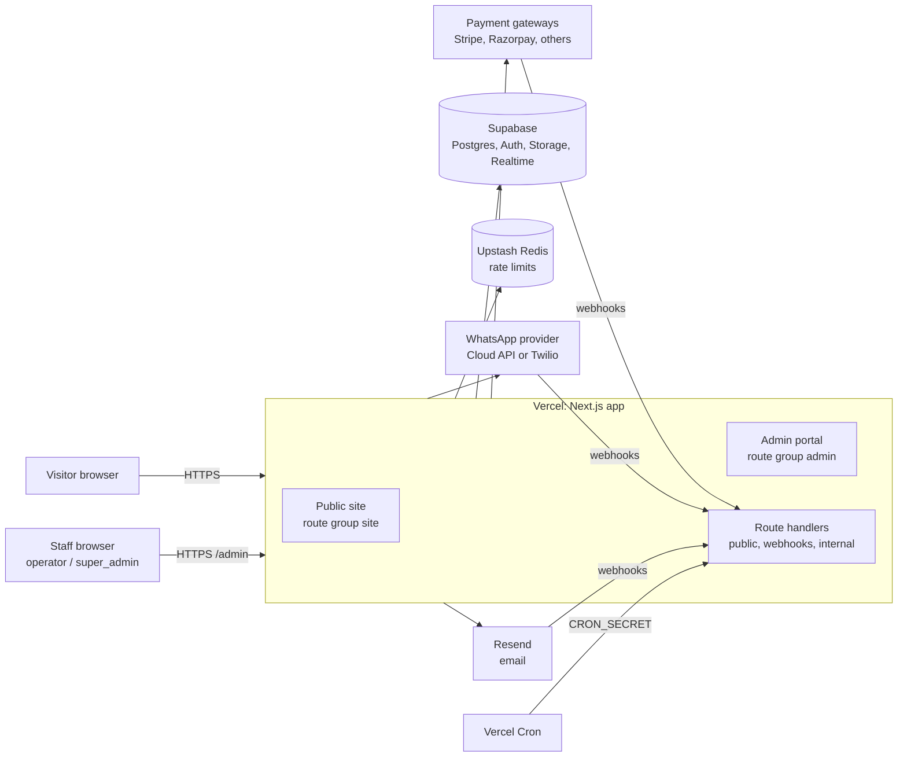
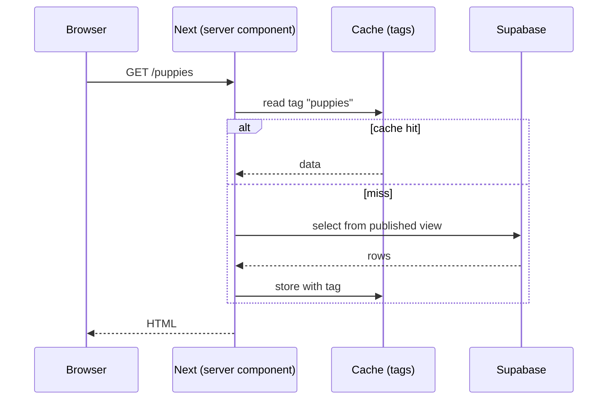
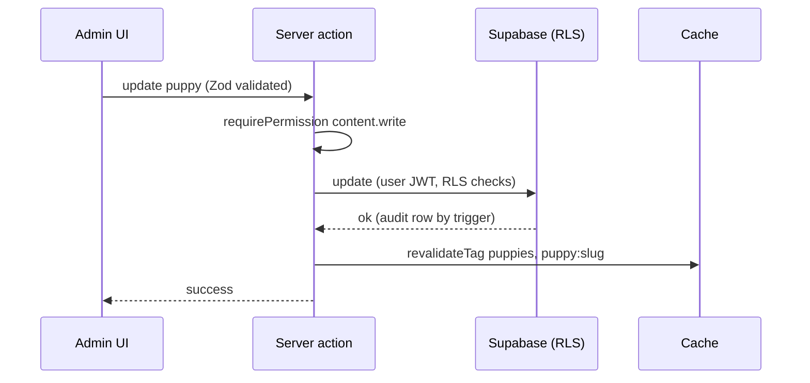
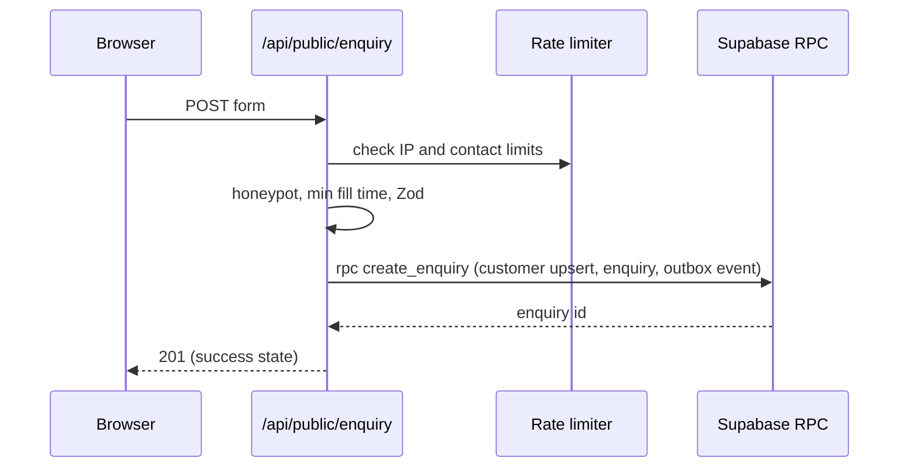
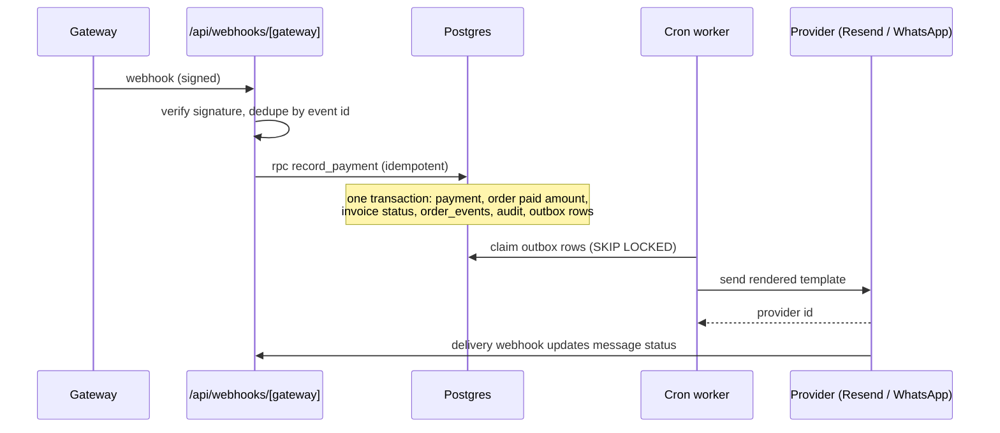
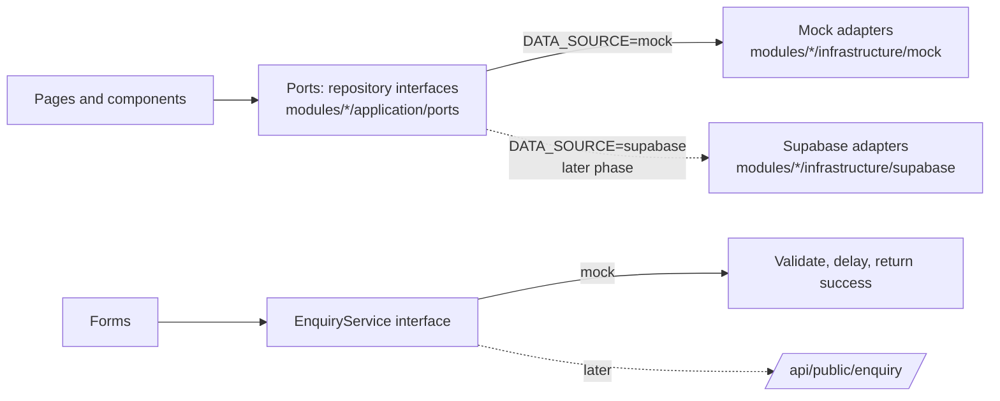

# 04. System Architecture

| | |
|---|---|
| **Status** | Draft, awaiting review |
| **Version** | 0.1 |
| **Date** | 2026-11-02 |
| **Related** | `05-data-model.md`, `06-security-architecture.md`, `08-api-and-rate-limiting.md`, `10`, `11`, `14` |

## 1. Context



## 2. Containers and responsibilities

| Container | Responsibility | Notes |
|---|---|---|
| **Next.js app (Vercel)** | Renders public pages (cached server components), the admin UI, server actions and route handlers | One deployment, two isolated route groups |
| **Supabase Postgres** | System of record; RLS as the authorisation layer; RPC functions for transactional workflows; sequences; triggers for audit and `updated_at` | Pooled connections for server code |
| **Supabase Auth** | Identities, email verification, password reset, MFA (TOTP), sessions | Sign-up disabled; invite only |
| **Supabase Storage** | `site-media` (public, published images and videos), `private-docs` (invoices, certificates, contracts) | Signed URLs for private files |
| **Supabase Realtime** | Live in-app notification bell | RLS applies |
| **Upstash Redis** | Sliding-window rate limits, short-lived counters | REST client, serverless safe |
| **Resend** | Transactional email and delivery webhooks | Provider adapter |
| **WhatsApp provider** | WhatsApp Cloud API or Twilio for customer messages, delivery and inbound webhooks | Provider adapter, env-selected |
| **Payment gateways** | Hosted checkout, webhooks, refunds | Adapter interface, env-selected, `manual` always present |
| **Vercel Cron** | Triggers the outbox worker every minute and daily jobs (overdue invoices, retention) | Authenticated with `CRON_SECRET` |

## 3. Application structure: modular monolith

**Decision (owner, 2026-11-02):** one deployable Next.js application organised as a **modular monolith** with an enterprise layered structure (domain, application/business logic, infrastructure, presentation, shared functions, navigation, composition). The full specification is in `21-modular-monolith-architecture.md`; this section is the summary.

```
src/
  app/            Next.js routing shell only: (site) pages, (admin) later, api route handlers, thin
  modules/        business modules, each with domain / application / infrastructure / presentation
    catalog/  content/  crm/  storefront/            frontend track
    commerce/ billing/ messaging/ identity/ backoffice/   backend track (later)
  shared/         kernel (Result, errors, Money, Clock), lib (pure functions), ui (design system), config (env)
  navigation/     route registry, menus, breadcrumbs, guards, link builders, metadata
  platform/       cross-cutting: cache, ratelimit, logger, events, http, security, db and storage clients
  composition/    composition root: wires ports to adapters (mock now, Supabase later), module registry
  middleware.ts   admin gate, rate limits, headers
tests/  architecture | e2e | fixtures
scripts/  one-off tools (extract-fixtures)
supabase/ migrations | seed.sql | tests         backend track
```

Rules (details and the full import matrix in `21` section 6):
- Dependencies point inward: `presentation → application → domain`; `infrastructure` implements application ports.
- A module is used by others only through its `index.ts` public API or domain events; no deep imports; no cycles.
- `app/` files contain no business logic; they resolve a use case from the composition root and render a module section.
- `shared` has no business knowledge; `navigation` holds all routes and links; only `shared/config` reads the environment.
- Nothing under `(admin)` or any backend module is imported by the public site; the admin gate and no-SEO rules in `06` section 2 still apply.
- The browser never talks to Postgres with a privileged key; public reads use published views through the Supabase adapters (backend track).

## 4. Key flows

### 4.1 Public page render



### 4.2 Admin publishes content



### 4.3 Public enquiry



### 4.4 Payment and notification (outbox)



## 5. Caching and revalidation

| Data | Cache tag | Revalidated when |
|---|---|---|
| Published puppies list, filters data | `puppies` | Any puppy create, update, publish, status change, media change |
| Puppy detail | `puppy:{slug}` | That puppy or its media changes |
| Gone home | `gone-home` | Status change to or from gone_home |
| Families | `families` | Family photo or testimonial change |
| FAQs | `faqs` | FAQ change |
| Site settings | `settings` | Setting change |

Admin pages are never cached (`no-store`). The public site tolerates a few seconds of staleness after publish.

## 6. Environments

| Env | Purpose | Notes |
|---|---|---|
| Local | Development with the Supabase CLI (local Postgres/Auth/Storage), Resend and gateway test modes | `.env.local` |
| Preview | Per-PR Vercel deployments against a staging Supabase project | Separate keys, `noindex` for the whole site |
| Production | Live | Separate Supabase, Upstash, Resend, gateway live keys; PITR enabled |

Staging and production never share keys or databases.

## 7. Scaling and limits

- Public traffic is absorbed by cached rendering; database load scales with admin use, not visits.
- Admin queries use indexes and cursor pagination (`09`).
- The outbox worker is horizontally safe thanks to `FOR UPDATE SKIP LOCKED`.
- Storage serves media through the CDN with image transformation limits; originals are size-capped on upload.

## 8. Technology choices (summary; rationale in `16`)

Next.js, TypeScript, Tailwind v4, Zod, Supabase, Upstash, Resend, Stripe and Razorpay adapters, WhatsApp Cloud API or Twilio, Vercel. Lenis for smooth scroll and CSS scroll-driven animations for the public site, matching the reference.

## 9. Frontend-first delivery: data access boundary

Owner decision (2026-11-02): ship the frontend first on mock data, add the backend later.



Rules:
- Pages and components depend only on use cases, DTOs and domain types of the owning module (the same shapes as the later `v_public_*` views, see `20-mock-data-spec.md`); ports live in `modules/<m>/application/ports`.
- No Supabase client, no admin route group, no auth, payments or messaging code exists in the frontend track.
- The public caching and `revalidateTag` flow in section 5 is added with the Supabase repositories; mock data needs none.
- The folder layout in section 3 is the target; during the frontend track only `app/(site)`, the modules `catalog`, `content`, `crm`, `storefront`, `shared`, `navigation`, `composition` and the needed `platform` pieces exist (`21` section 18).
- Switching to the backend is a configuration change plus new repository implementations, not a rewrite.

## Open questions

1. Single Vercel project for site and admin (assumed) or two projects behind one domain?
2. Is a custom domain available for the production deployment and email sending (SPF/DKIM)?
3. Supabase region (closest to UAE users)?
