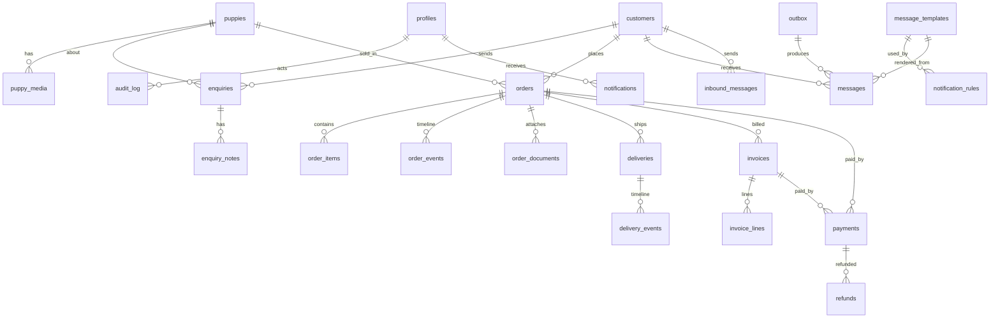
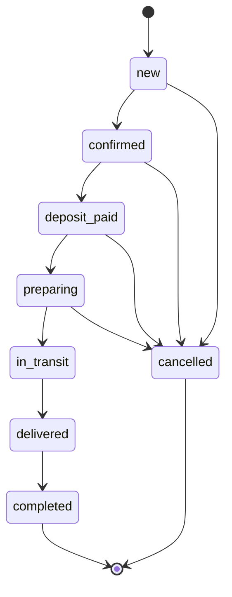

# 05. Data Model

| | |
|---|---|
| **Status** | Draft, awaiting review |
| **Version** | 0.1 |
| **Date** | 2026-11-02 |
| **Related** | `07-rbac-and-rls-spec.md`, `09-query-optimization-guide.md`, `10`, `11` |

## 1. Conventions

- Primary keys: `uuid default gen_random_uuid()`. Human-readable numbers (orders, invoices, tracking) are separate columns.
- Timestamps: `created_at timestamptz default now()`, `updated_at` maintained by a trigger.
- Money: **integer minor units + `currency char(3)`**; never floating point. Default currency AED (configurable).
- Soft delete (`deleted_at`) on customers, puppies, families, faqs, templates; financial records are never deleted.
- Actor columns: `created_by uuid references auth.users` where relevant.
- Enumerations are Postgres enums (or checked text where evolution is expected); transitions are enforced by triggers (section 4).
- Phone numbers are stored normalised to E.164 in `phone_e164` plus the display value.
- Private schema `app_private` holds helper functions; `public` exposes only tables and views protected by RLS.

## 2. Entity relationship overview

## 3. Tables

Column lists show important columns only; every table also has the standard columns above. `PK` primary key, `FK` foreign key, `U` unique, `N` nullable.

### 3.1 Identity and security

| Table | Columns | Notes |
|---|---|---|
| `profiles` | `user_id` PK FK auth.users; `full_name`; `role` enum(`super_admin`,`operator`); `can_edit_templates` bool; `mfa_required` bool; `disabled_at` N; `last_seen_at` N | One row per staff user; created at invite time |
| `role_permissions` | `role`, `permission` text; PK(role, permission) | Source of truth for the permission matrix (`07`) |
| `login_attempts` | `email_hash`, `ip_hash`, `success` bool, `created_at` | For lockout and forensics; pruned after 30 days |
| `audit_log` | `id` bigint identity; `actor_id` N; `action` text; `entity` text; `entity_id` N; `before` jsonb N; `after` jsonb N; `ip_hash` N; `user_agent` N; `request_id` N; `created_at` | Append-only; no update or delete policy |
| `idempotency_keys` | `key` text PK; `scope`; `response_hash`; `created_at` | Prevents duplicate creates |
| `webhook_events` | `gateway` text; `event_id` text; `received_at`; `processed_at` N; PK(gateway, event_id) | Webhook de-duplication |

### 3.2 Content

| Table | Columns | Notes |
|---|---|---|
| `puppies` | `slug` U; `name` N; `breed`; `breed_group` (for filters: maltipoo, pomeranian, poodle, cavapoo, shih-tzu, other); `sex` enum(boy, girl, pair); `age_text`; `origin` enum(local, imported); `is_korean_teacup` bool; `status` enum(available, reserved, gone_home); `story` N; `price_minor` N (internal only); `currency`; `has_video` bool (derived); `sort_order`; `published_at` N; `gone_home_at` N; `deleted_at` N | Public views expose only published rows and never the price |
| `puppy_media` | `puppy_id` FK; `kind` enum(photo, video); `storage_path`; `alt`; `sort_order`; `is_cover` bool; `width`, `height`; `blur_data_url` N | Max one cover per puppy (partial unique index) |
| `families` | `storage_path`; `alt`; `caption` N; `sort_order`; `published_at` N; `deleted_at` N | Photo wall (64 in the reference) |
| `testimonials` | `quote`; `author`; `location`; `is_featured` bool; `published_at` N | One featured at a time |
| `faqs` | `question`; `answer`; `sort_order`; `published_at` N; `deleted_at` N | 9 in the reference |
| `site_settings` | `key` text PK; `value` jsonb; `is_public` bool | Phone, WhatsApp number and text, email, address, maps link, social links, hero copy |

### 3.3 CRM

| Table | Columns | Notes |
|---|---|---|
| `customers` | `full_name`; `phone_e164` N; `phone_display` N; `email` N; `area` N; `language` default 'en'; `notes` N; `tags` text[]; `notification_prefs` jsonb (email, whatsapp); `whatsapp_opt_in_at` N; `whatsapp_opt_in_source` N; `whatsapp_opted_out_at` N; `source`; `deleted_at` N; `anonymised_at` N | Duplicate detection on phone and email |
| `enquiries` | `customer_id` N FK; `puppy_id` N FK; `source` enum(contact_letter, puppy_enquiry, whatsapp, manual); `name`, `phone`, `email`, `area`, `message` (as submitted); `status` enum(new, contacted, qualified, converted, closed, spam); `assigned_to` N FK profiles; `ip_hash`; `user_agent`; `closed_at` N | Public submissions create this row |
| `enquiry_notes` | `enquiry_id` FK; `author_id` FK; `body` | Internal notes |

### 3.4 Commerce

| Table | Columns | Notes |
|---|---|---|
| `orders` | `number` U (`TP-YYYY-NNNNNN`); `customer_id` FK; `puppy_id` N FK; `type` enum(local, imported); `status` enum (section 4.1); `currency`; `total_minor`; `deposit_minor`; `paid_minor` (maintained by RPC); `balance_minor` generated; `cancel_reason` N; `notes` N; `assigned_to` N | |
| `order_items` | `order_id` FK; `description`; `quantity`; `unit_minor`; `puppy_id` N | Puppy plus extras (transport, vaccination, accessories) |
| `order_events` | `order_id` FK; `from_status`; `to_status`; `reason` N; `actor_id` N; `created_at` | Timeline |
| `order_documents` | `order_id` FK; `kind` enum(health_certificate, passport, contract, other); `storage_path`; `uploaded_by` | Private bucket |
| `deliveries` | `order_id` FK; `method` enum(showroom_pickup, dubai_delivery, international_cargo); `carrier` N; `tracking_no` N; `address` jsonb N; `eta` N; `status` enum (section 4.4); `delivered_at` N | |
| `delivery_events` | `delivery_id` FK; `status`; `note` N; `location` N; `occurred_at`; `actor_id` N | Customer-facing updates reference these |

### 3.5 Money

| Table | Columns | Notes |
|---|---|---|
| `invoices` | `number` U (`INV-YYYY-NNNNNN`); `order_id` FK; `customer_id` FK; `status` enum(draft, issued, partially_paid, paid, overdue, void); `currency`; `subtotal_minor`; `tax_minor`; `total_minor`; `paid_minor`; `issued_at` N; `due_at` N; `pdf_path` N; `void_reason` N | Issued invoices are immutable (trigger) |
| `invoice_lines` | `invoice_id` FK; `description`; `quantity`; `unit_minor`; `tax_rate_id` N | |
| `tax_rates` | `name`; `rate_bps` int (500 = 5%); `is_default` | UAE VAT 5% default (confirm) |
| `payments` | `order_id` FK; `invoice_id` N FK; `gateway` text; `gateway_ref` text; `method` enum(card, bank_transfer, cash, card_machine, link, other); `amount_minor`; `currency`; `status` enum(pending, succeeded, failed, refunded, partially_refunded); `paid_at` N; `recorded_by` N; `raw` jsonb N; U(gateway, gateway_ref) | Idempotency anchor |
| `refunds` | `payment_id` FK; `amount_minor`; `reason`; `status` enum(requested, approved, processed, failed, rejected); `requested_by`; `approved_by` N; `gateway_ref` N | Operators request, super admins approve |
| Sequences | `order_number_seq`, `invoice_number_seq`, `tracking_seq` (per year via helper table `number_counters(kind, year, last)`) | Numbers allocated inside RPCs |

### 3.6 Messaging and notifications

| Table | Columns | Notes |
|---|---|---|
| `message_templates` | `key`; `channel` enum(email, whatsapp); `locale`; `subject` N; `body`; `variables` text[] (allow-list); `version` int; `is_active`; `provider_template_name` N; `approval_status` enum(not_required, pending, approved, rejected); U(key, channel, locale, version) | Versioned |
| `notification_rules` | `event` text; `channel`; `template_key`; `recipient_type` enum(customer, assignee, staff_role, user); `recipient_ref` N; `enabled` bool; `delay_seconds` int | Edited by super admin |
| `outbox` | `id` bigint; `event` text; `entity` text; `entity_id`; `payload` jsonb; `status` enum(pending, processing, done, failed); `attempts` int; `next_attempt_at`; `locked_at` N; `dedupe_key` U N | Written in the same transaction as the change |
| `messages` | `customer_id` N; `order_id` N; `user_id` N (staff recipient); `channel`; `provider`; `to_address`; `template_key`; `subject` N; `body`; `status` enum(queued, sent, delivered, read, failed, handed_off); `provider_id` N; `error` N; `attempts`; `sent_by` N (null for automated); `outbox_id` N | Delivery log |
| `inbound_messages` | `customer_id` N; `channel`; `from_address`; `body`; `provider_id` U; `received_at` | Replies, STOP handling |
| `notifications` | `user_id` FK; `type`; `title`; `body`; `entity`; `entity_id`; `read_at` N | In-app bell |

### 3.7 Privacy and data protection

| Table | Columns | Notes |
|---|---|---|
| `consent_records` | `customer_id` FK; `purpose` enum(`enquiry_reply`, `marketing_email`, `whatsapp_updates`, `photo_publication`); `text_version`; `given_at`; `channel`; `source`; `ip_hash`; `withdrawn_at` N; `withdrawal_channel` N; `release_ref` N (photo releases) | Append-style; a withdrawal sets `withdrawn_at`; never edited otherwise |
| `dsr_requests` | `subject_ref` (customer id or contact hash); `type` enum(access, rectification, erasure, restriction, portability, objection, withdrawal, grievance); `received_at`; `due_at`; `status` enum(received, verifying, in_progress, completed, rejected, extended); `handler_id` N; `identity_verified_at` N; `exceptions` text N; `export_path` N; `completed_at` N | Due date defaults to received + `DSR_SLA_DAYS` (30) |
| `privacy_incidents` | `detected_at`; `aware_at`; `summary`; `data_categories`; `people_affected` N; `risk_level`; `authority_notified_at` N; `individuals_notified_at` N; `decision_reason`; `status`; `owner_id` | Breach register (`06` section 6.10) |

Privacy-related changes to existing tables: `customers.restricted_at` N (processing restriction), `customers.anonymised_at` (exists), photo releases linked from `families` (`release_ref`).

## 4. State machines

Transitions are validated by `BEFORE UPDATE` triggers; invalid moves raise an error. Every valid move writes an `order_events`/`delivery_events` row, an `audit_log` row and, when configured, an `outbox` row.

### 4.1 Orders

Local showroom orders may skip `preparing` and `in_transit`. Cancelling requires a reason; `deposit_paid` to `cancelled` requires a refund decision (super admin).

### 4.2 Payments

`pending → succeeded | failed`; `succeeded → partially_refunded → refunded`. A `failed` payment may be retried as a new row.

### 4.3 Invoices

`draft → issued → partially_paid → paid`; `issued/partially_paid → overdue` (daily job) and back on payment; `draft/issued → void` (super admin only, reason required). Paid invoices cannot be voided without a credit note (out of scope, flagged).

### 4.4 Deliveries

`scheduled → packed → dispatched → in_transit → arrived → delivered`; `delayed` can interleave; `failed` terminal with note.

### 4.5 Enquiries

`new → contacted → qualified → converted | closed`; `spam` terminal.

### 4.6 Puppies

`available → reserved → gone_home`; `reserved → available` when an order is cancelled.

## 5. Transactional RPCs (database functions)

| Function | Purpose |
|---|---|
| `create_enquiry(payload)` | Public submission: validate, upsert customer, insert enquiry, write outbox, return id. `SECURITY DEFINER`, granted to `anon`. |
| `create_order(...)` | Allocates number, creates order and items, reserves puppy, writes event and outbox. |
| `transition_order(order_id, to, reason)` | Validates and records a status change. |
| `record_payment(order_id, invoice_id, gateway, ref, method, amount, ...)` | Idempotent insert, recompute `paid_minor`, update invoice and order status, outbox. |
| `request_refund(...)`, `approve_refund(...)` | Two-step refund with permission checks. |
| `issue_invoice(invoice_id)` | Allocates number, locks lines, sets due date, outbox. |
| `record_delivery_event(...)` | Appends event, updates delivery status, outbox. |
| `void_invoice(invoice_id, reason)` | Super admin only; sets status void, records reason, outbox. |
| `get_order_bundle(order_id)` | One JSON document with order, items, events, deliveries, payments, invoices (avoids N+1). |
| `transition_delivery(delivery_id, to, note)` | Validates delivery status moves; same pattern as orders. |
| `admin_dashboard_stats()` | One JSON row of counts and sums. |
| `claim_outbox(batch)` | `FOR UPDATE SKIP LOCKED` claim for the worker. |
| `mark_overdue_invoices()`, `anonymise_old_records()` | Daily jobs. |

## 6. Views (public read model)

| View | Exposes |
|---|---|
| `v_public_puppies` | Published, non-deleted, non-gone-home puppies with cover and media counts (no price, no internal notes) |
| `v_public_puppy_detail` | One puppy with ordered media |
| `v_public_gone_home` | Published gone-home puppies with cover |
| `v_public_families`, `v_public_faqs`, `v_public_testimonial`, `v_public_settings` | Published rows only; settings limited to `is_public` |

## 7. Indexing summary (details and reasons in `09`)

Unique: `puppies(slug)`, `orders(number)`, `invoices(number)`, `payments(gateway, gateway_ref)`, `outbox(dedupe_key)`, `inbound_messages(provider_id)`.
Query indexes: `puppies(status, published_at desc) where published_at is not null`; `puppy_media(puppy_id, sort_order)`; `enquiries(status, created_at desc)`; `enquiries(assigned_to, created_at desc) where status not in ('closed','spam')`; `orders(status, created_at desc)`; `orders(customer_id, created_at desc)`; `deliveries(order_id)`, `deliveries(status, eta)`; `payments(order_id)`; `invoices(status, due_at)`; `messages(customer_id, created_at desc)`; `outbox(status, next_attempt_at)`; `notifications(user_id, read_at, created_at desc)`; `audit_log(entity, entity_id, created_at desc)`; trigram GIN on `customers(full_name, phone_e164, email)`.

## 8. Seed data

From the reference: 15 available puppies, 27 gone-home puppies, 9 FAQs, 64 family photo slots (placeholders), 1 testimonial, site settings (phone +971 54 167 6733, Downtown Dubai address, social links, WhatsApp text), default tax rate, notification rules and templates. Real photos only if the owner permits.

## 9. Retention

| Data | Default retention (to confirm) |
|---|---|
| Enquiries and messages | Anonymised after 24 months |
| Login attempts | 30 days |
| Audit log | 7 years (financial and security relevance) |
| Invoices, payments | Per UAE record-keeping rules (confirm; assume 5 to 7 years; `06` uses 7 years) |
| Outbox done rows | 30 days |
| Consent and data-request records | Relationship + 3 years (`06` section 6.7) |
| Order, invoice and payment records | 7 years (verify); detail and legal basis in `06` section 6.7 |
| Family photo releases | Until withdrawn, then the release record 3 years |

## 9b. Table ownership by module (modular monolith)

Each module owns its tables; other modules use its public API, never its tables (`21` section 7).

| Module | Tables and objects owned |
|---|---|
| `catalog` | `puppies`, `puppy_media`; views `v_public_puppies`, `v_public_puppy_detail`, `v_public_gone_home` |
| `content` | `families`, `testimonials`, `faqs`, `site_settings`; views `v_public_families`, `v_public_faqs`, `v_public_testimonial`, `v_public_settings` |
| `crm` | `customers`, `enquiries`, `enquiry_notes`, `consent_records`, `dsr_requests`; RPC `create_enquiry` |
| `commerce` | `orders`, `order_items`, `order_events`, `order_documents`, `deliveries`, `delivery_events` |
| `billing` | `invoices`, `invoice_lines`, `tax_rates`, `payments`, `refunds`, `number_counters` |
| `messaging` | `message_templates`, `notification_rules`, `outbox`, `messages`, `inbound_messages`, `notifications` |
| `identity` | `profiles`, `role_permissions`, `login_attempts`, `audit_log`, `privacy_incidents` |
| `assistant` (AI track, planned) | `assistant_conversations`, `assistant_messages` (redacted text, short retention), `assistant_feedback`, `assistant_trajectories`, `assistant_policies` (see `27`, `28`, `29`) |
| `platform` (technical) | `idempotency_keys`, `webhook_events` |

## Open questions

1. Is VAT charged (5%)? Which invoice numbering format does the owner want?
2. Are prices stored for puppies at all, or only per order?
3. Do invoices need credit notes (refund after paid)?
4. Multiple currencies per order, or one currency per order (assumed)?
