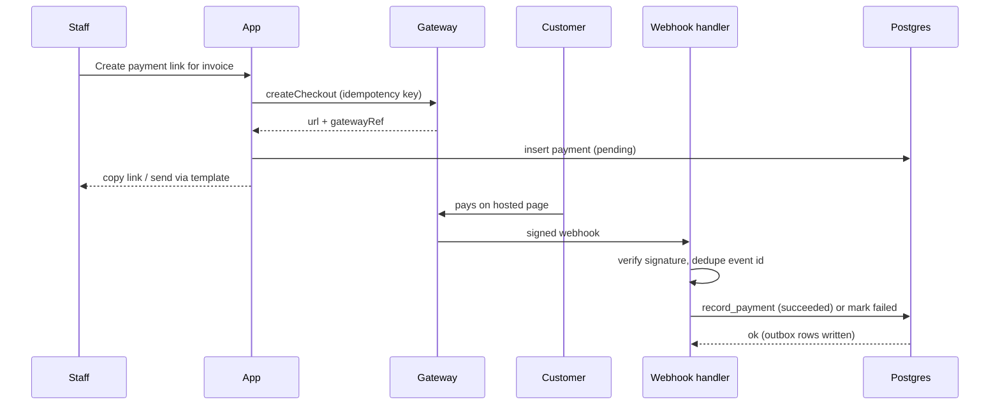

# 10. Payments Architecture

| | |
|---|---|
| **Status** | Draft, awaiting review |
| **Version** | 0.1 |
| **Date** | 2026-11-02 |
| **Related** | `05-data-model.md`, `06`, `07`, `08`, `11`, `14` |

## 1. Goals

- Monitor every payment against orders and invoices in one ledger.
- Support **several gateways selected by environment configuration**: Stripe, Razorpay and others, plus a built-in `manual` gateway for cash, bank transfer and card machine.
- Be safe under retries, duplicate webhooks and partial failures.
- Keep card data out of the application entirely.

## 2. Adapter interface

```ts
interface PaymentGateway {
  id: string                                  // 'stripe' | 'razorpay' | 'manual' | ...
  displayName: string
  supports: { checkout: boolean; refunds: boolean; currencies: string[] }
  createCheckout(input: {
    orderId: string; invoiceId?: string; amountMinor: number; currency: string
    customer: { name: string; email?: string; phone?: string }
    successUrl: string; cancelUrl: string; idempotencyKey: string
  }): Promise<{ url: string; gatewayRef: string }>
  verifyWebhook(req: Request): Promise<GatewayEvent | null>   // null = ignorable
  refund(input: { paymentGatewayRef: string; amountMinor: number; reason?: string; idempotencyKey: string }): Promise<{ gatewayRef: string }>
}

type GatewayEvent =
  | { type: 'payment.succeeded'; eventId: string; gatewayRef: string; amountMinor: number; currency: string; paidAt: string; metadata: { orderId: string; invoiceId?: string }; raw: unknown }
  | { type: 'payment.failed'; eventId: string; gatewayRef: string; reason?: string; metadata: ...; raw: unknown }
  | { type: 'refund.processed'; eventId: string; gatewayRef: string; paymentGatewayRef: string; amountMinor: number; raw: unknown }
```

The core app never imports a gateway SDK directly. It talks to `registry.get(id)`.

## 3. Registry and environment selection

`modules/billing/infrastructure/gateways/registry.ts` builds the active set at boot from env (validated by `shared/config/env.ts`):

| Variable | Meaning |
|---|---|
| `PAYMENT_GATEWAYS` | Comma list of gateways to enable, for example `stripe,razorpay,manual` |
| `DEFAULT_GATEWAY` | Gateway preselected in the UI (must be in the list) |
| `DEFAULT_CURRENCY` | ISO code, default `AED` |
| `STRIPE_SECRET_KEY`, `STRIPE_PUBLISHABLE_KEY`, `STRIPE_WEBHOOK_SECRET` | Stripe |
| `RAZORPAY_KEY_ID`, `RAZORPAY_KEY_SECRET`, `RAZORPAY_WEBHOOK_SECRET` | Razorpay |
| `PAYMENT_<ID>_*` | Pattern reserved for further gateways (documented per adapter) |

Rules:
- A gateway named in `PAYMENT_GATEWAYS` but missing required secrets is **not registered**; boot logs a warning and the admin UI lists it as "not configured".
- `manual` is always registered, even if omitted from the list.
- A gateway that does not support the order currency is hidden for that order.
- Switching gateways needs no code change or database migration; `payments.gateway` is text.
- The settings page shows which gateways are active and in test or live mode (derived from key prefixes), never the secrets.

## 4. Flows

### 4.1 Manual payment

1. Staff opens an order or invoice and chooses **Record payment**: method (cash, bank transfer, card machine, other), amount, date, reference note.
2. Server action validates, then calls `record_payment` (idempotency key from the form).
3. Database transaction: insert payment `succeeded`, update `orders.paid_minor` and order status (for example to `deposit_paid` when the deposit threshold is met), update invoice `paid_minor` and status, write `order_events`, audit and outbox (`payment.succeeded`).
4. UI shows the updated balance. Receipt message is queued by notification rules.

### 4.2 Hosted checkout (Stripe, Razorpay, others)



The browser return URL is informational only; **only the webhook changes payment state**. A reconciliation job (daily) lists pending payments older than 24 hours and asks the gateway for their status.

### 4.3 Refunds

1. Operator opens a payment and chooses **Request refund** with amount and reason (`payments.refund.request`). Status `requested`.
2. Super admin reviews and chooses **Approve** (`payments.refund.approve`, step-up MFA). For gateway payments the adapter's `refund()` is called with an idempotency key; for manual payments the approver records the method used (for example bank transfer).
3. On success the refund becomes `processed`; payment status becomes `partially_refunded` or `refunded`; order and invoice balances are recomputed; outbox queues `payment.refunded`.
4. Failures keep the refund `failed` with the error for retry; nothing is silently lost.

### 4.4 Failed and abandoned payments

`payment.failed` marks the row failed and queues a staff alert (in-app, and email to super admin). A new payment attempt creates a new row.

## 5. Invariants (enforced in the database)

| Invariant | Mechanism |
|---|---|
| A gateway reference is recorded once | Unique `(gateway, gateway_ref)` |
| `orders.paid_minor` equals the sum of succeeded payments minus processed refunds | Updated only by RPCs; nightly consistency check job reports drift |
| Amounts are positive integers in the order's currency | CHECK constraints, currency match in RPC |
| Overpayment is flagged, not silently accepted | RPC returns warning, row stored with `overpaid` note, alert raised |
| Issued invoices are immutable; payments adjust only `paid_minor` and status | Trigger |
| Refund total never exceeds the payment amount | Constraint check in `approve_refund` |

## 6. Reporting and monitoring

- Ledger filters: date, gateway, method, status, order, customer.
- Dashboard: payments this month, outstanding balance, overdue invoices, failed payments last 7 days.
- Daily reconciliation report (in-app notification for super admins) listing mismatches: pending too long, webhook missing, paid total drift.
- Exports are super-admin only (`payments.export`), rate limited and audited.

## 7. Security and compliance

- Hosted checkout only; no PAN, CVV or card details enter or are stored by the app (SAQ-A-like scope).
- Webhook secrets and API keys are env-only; keys rotate without a deploy through Vercel env updates.
- Idempotency keys on every outbound gateway call.
- Test and live modes separated by environment; a banner shows "TEST MODE" in admin when test keys are detected.
- Amount and currency are always derived from the invoice or order on the server; the client cannot set them.

## 8. Gateway notes (verify before relying on them)

| Gateway | Notes and cautions |
|---|---|
| Stripe | Supports AED. Availability for the merchant's business entity must be confirmed (UAE accounts are supported by Stripe; check onboarding). Webhook events used: `checkout.session.completed`, `payment_intent.payment_failed`, `charge.refunded`. |
| Razorpay | Primarily serves Indian businesses and INR; international and UAE support is limited. Confirm eligibility before committing; keep the adapter optional. |
| Others (Tap, Network International, PayTabs, Checkout.com) | Common in the UAE; each needs an adapter implementing the interface. Out of scope for v1, shape allows it. |
| Manual | Always available; the default for v1 so the ledger works without a gateway account. |

## 9. Testing

Gateway test modes plus fixtures: valid, invalid-signature, replayed, out-of-order and duplicate webhooks; partial refunds; currency mismatch; overpayment; adapter missing secrets. See `15`.

## Open questions

1. Which gateway(s) will actually be live on day one (affects effort)?
2. Is a deposit percentage fixed (for example 30%) or per order?
3. Are credit notes needed for refunds after full payment?
4. Is VAT included in prices or added on top?
