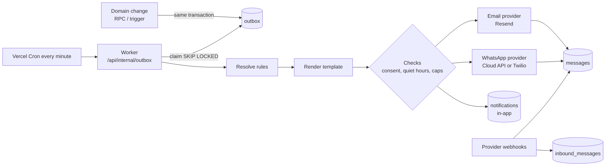

# 11. Notifications and Messaging

| | |
|---|---|
| **Status** | Draft, awaiting review |
| **Version** | 0.1 |
| **Date** | 2026-11-02 |
| **Related** | `05-data-model.md`, `08`, `10`, `12`, `14` |

## 1. Goals

Keep customers and staff informed automatically about enquiries, orders, deliveries, payments and invoices, across **email, WhatsApp (via cloud providers) and in-app**, with reliable delivery, consent handling and a complete log.

## 2. Architecture



Transactional outbox: the event row is committed with the business change, so a rollback sends nothing and a crash after commit loses nothing.

## 3. Providers (adapter interface)

```ts
interface MessageProvider {
  id: string                         // 'resend' | 'whatsapp_cloud' | 'twilio' | ...
  channel: 'email' | 'whatsapp'
  send(msg: {
    to: string; templateKey: string; locale: string
    subject?: string; body: string                       // rendered
    providerTemplate?: { name: string; language: string; params: string[] }  // WhatsApp approved templates
    idempotencyKey: string
  }): Promise<{ providerId: string }>
  verifyWebhook(req: Request): Promise<ProviderEvent[]>
}
type ProviderEvent =
  | { kind: 'status'; providerId: string; status: 'sent'|'delivered'|'read'|'failed'; error?: string; eventId: string }
  | { kind: 'inbound'; providerId: string; from: string; body: string; receivedAt: string; eventId: string }
```

| Channel | Provider | Env selection |
|---|---|---|
| Email | Resend (default); adapter pattern allows Postmark or SES | `EMAIL_PROVIDER=resend`, `RESEND_API_KEY`, `RESEND_WEBHOOK_SECRET`, `EMAIL_FROM` |
| WhatsApp | WhatsApp Cloud API (Meta) or Twilio | `WHATSAPP_PROVIDER=cloud|twilio|none` with `WHATSAPP_PHONE_NUMBER_ID`, `WHATSAPP_ACCESS_TOKEN`, `WHATSAPP_APP_SECRET`, `WHATSAPP_WEBHOOK_VERIFY_TOKEN` or `TWILIO_ACCOUNT_SID`, `TWILIO_AUTH_TOKEN`, `TWILIO_WHATSAPP_FROM` |
| In-app | Database plus Supabase Realtime | none |
| Manual fallback | Prefilled `wa.me` link and `mailto:` | used when no provider is configured |

A provider without its keys is not registered. If WhatsApp is `none`, rules for the WhatsApp channel are skipped with a visible "channel unavailable" status and staff get a manual button.

## 4. Event catalogue

| Event key | Raised by | Customer message | Staff notification |
|---|---|---|---|
| `enquiry.created` | `create_enquiry` | Acknowledgement | In-app to on-duty staff; email to configured address |
| `enquiry.assigned` | assignment change | none | In-app to assignee |
| `enquiry.status_changed` | status change | optional | In-app to assignee |
| `order.confirmed` | transition to `confirmed` | Order confirmation | In-app |
| `order.status_changed` | any transition | Status update | In-app |
| `order.cancelled` | cancel | Cancellation notice | In-app + alert to super admin |
| `delivery.dispatched` | delivery event | Tracking number, carrier, ETA | In-app |
| `delivery.in_transit` | event | Update | In-app |
| `delivery.delayed` | event | Delay notice | In-app + alert |
| `delivery.arrived` / `delivery.delivered` | event | Arrival and care tips | In-app |
| `invoice.issued` | `issue_invoice` | Invoice link and PDF | In-app |
| `invoice.overdue` | daily job | Reminder | In-app digest |
| `invoice.void` | void | Void notice | In-app + audit |
| `payment.succeeded` | `record_payment` | Receipt | In-app |
| `payment.failed` | webhook | Failure notice with retry link | In-app + email to super admin |
| `payment.refunded` | `approve_refund` | Refund notice | In-app + email to super admin |
| `message.failed` | worker (final failure) | none | In-app alert |
| `system.reconciliation` | daily job | none | In-app digest to super admins |

## 5. Rules

`notification_rules` rows map **event + channel → template + recipient type + enabled + delay**. Recipient types: `customer`, `assignee`, `staff_role` (for example all super admins), `user`. Super admins edit rules in the portal; defaults ship in the seed. Examples:

| Event | Channel | Template key | Recipient |
|---|---|---|---|
| `enquiry.created` | email | `enquiry_received` | customer (if email) |
| `enquiry.created` | whatsapp | `enquiry_received_wa` | customer (if opted in) |
| `enquiry.created` | in_app | n/a | staff_role operator |
| `payment.succeeded` | email | `payment_receipt` | customer |
| `delivery.dispatched` | whatsapp | `delivery_dispatched_wa` | customer |
| `payment.failed` | email | `payment_failed_staff` | staff_role super_admin |

## 6. Worker behaviour

1. Cron calls `/api/internal/outbox` each minute (bearer `CRON_SECRET`); an immediate best-effort call also follows important commits.
2. `claim_outbox(batch)` selects up to N due rows `FOR UPDATE SKIP LOCKED`, marks them `processing`.
3. For each event: find enabled rules; for each recipient resolve address, channel preferences and consent.
4. **Checks** before sending: customer preference for the channel; WhatsApp opt-in and not opted out; quiet hours (`QUIET_HOURS_START/END` in `QUIET_HOURS_TZ`, default 21:00 to 08:00 Asia/Dubai, transactional receipts exempt by rule flag); per-customer cap (`AUTOMATED_MSG_DAILY_CAP`, default 5) and global provider cap. A failed check defers the row (`next_attempt_at`) or skips with a recorded reason.
5. Render template with allow-listed variables, create `messages` row (`queued`), call provider with an idempotency key built from `outbox.id + recipient + channel`.
6. On success set `sent` and store `provider_id`; on error increment attempts, back off (1, 5, 15, 60, 240 minutes) and finally mark `failed` and raise `message.failed`.
7. Provider webhooks update status to `delivered`, `read` or `failed` and insert inbound replies.
8. Rows older than 30 days in `done` state are pruned daily.

Idempotency and ordering: same dedupe key never creates two messages; status updates only move forward (`queued → sent → delivered → read`, `failed` terminal unless retried).

## 7. Templates

- Key, channel, locale, version; one active version per (key, channel, locale).
- Variables are allow-listed per template, from this set: `customer.name`, `customer.first_name`, `order.number`, `order.status`, `order.total`, `order.balance`, `puppy.name`, `puppy.breed`, `delivery.method`, `delivery.tracking_no`, `delivery.eta`, `delivery.carrier`, `invoice.number`, `invoice.total`, `invoice.due_date`, `invoice.url`, `payment.amount`, `payment.method`, `payment.reference`, `business.name`, `business.phone`.
- Rendering: simple `{{variable}}` substitution with no logic or code; unknown variable fails validation at save; values escaped for the channel (HTML for email, plain text for WhatsApp).
- Email bodies use a shared layout (React Email) with text alternative and unsubscribe footer where required.
- WhatsApp: templates map to **pre-approved Meta templates** (`provider_template_name`, language, ordered params). Free-form text is only allowed within the 24-hour customer service window (replies). Template approval status is tracked; unapproved templates cannot be activated for automation.
- Features in the editor: preview with sample data, test-send to a chosen address or number, version history, rollback, and usage list (which rules use it).

Seed templates: `enquiry_received`, `enquiry_assigned_staff`, `order_confirmed`, `order_status_update`, `deposit_received`, `payment_receipt`, `payment_failed_customer`, `payment_failed_staff`, `refund_issued`, `invoice_issued`, `invoice_reminder`, `delivery_dispatched`, `delivery_delayed`, `delivery_arrived`, `post_delivery_care`, each in email and, where useful, WhatsApp form.

## 8. Consent, preferences and compliance

The binding consent standard, lawful bases, retention and rights procedures are in `06` section 6 (6.5 to 6.7); this section applies them to messaging.

- `customers.notification_prefs` (per channel on/off, language) and WhatsApp opt-in timestamp and source (form checkbox, verbal consent recorded by staff, inbound message).
- Transactional messages (receipts, order and delivery updates) are sent on the customer's chosen channels; marketing is out of scope.
- STOP/UNSUBSCRIBE keywords on inbound WhatsApp set `whatsapp_opted_out_at`; emails carry an unsubscribe link for non-essential messages.
- Quiet hours, caps and a global kill switch (`FEATURE_OUTBOX_ENABLED`) protect against runaway sends.
- Messages store the rendered body; access limited by `messages.read`; retention per `05`.

## 9. In-app notifications

- Table `notifications` per user; created by the worker or by RPCs for staff recipients.
- The admin shell subscribes to Realtime inserts filtered by `user_id`; bell shows unread count; `/admin/notifications` lists and marks read.
- Types: info, action needed (for example refund requested), alert (failures). Click opens the related record.
- Optional daily digest email to staff (`FEATURE_STAFF_DIGEST`).

## 10. Manual messaging

Staff can send a template to a customer from the customer, order or enquiry page: choose channel, preview, send. Uses the same pipeline (marked `sent_by`), obeys opt-in and rate limit RL-MSG-1. If WhatsApp has no provider, the UI offers an **Open in WhatsApp** prefilled `wa.me` link and logs a `handed_off` message when staff confirm.

## 11. Observability

Message log filters: status, channel, template, customer, date. Failure view with error and retry. Metrics: sent, delivered, failed per day; webhook lag; outbox backlog age (alert if oldest pending > 10 minutes).

## 12. Testing

Outbox atomicity (rollback creates none); worker concurrency (two workers, no duplicates); retry/backoff and final failure; consent and quiet-hour rules; template variable validation and escaping; provider webhook signatures and replays; inbound STOP handling; in-app RLS (only the owner sees a notification). See `15`.

## Open questions

1. WhatsApp provider choice (Cloud API or Twilio) and the sender number; Meta business verification timeline.
2. Which languages are needed for templates (English only, or Arabic as well)?
3. Quiet hours and whether receipts may bypass them.
4. Customer-facing wording for consent on the public forms.
5. Should customers be able to reply and have staff answer from the portal (two-way inbox), or is replying through the WhatsApp app enough?
