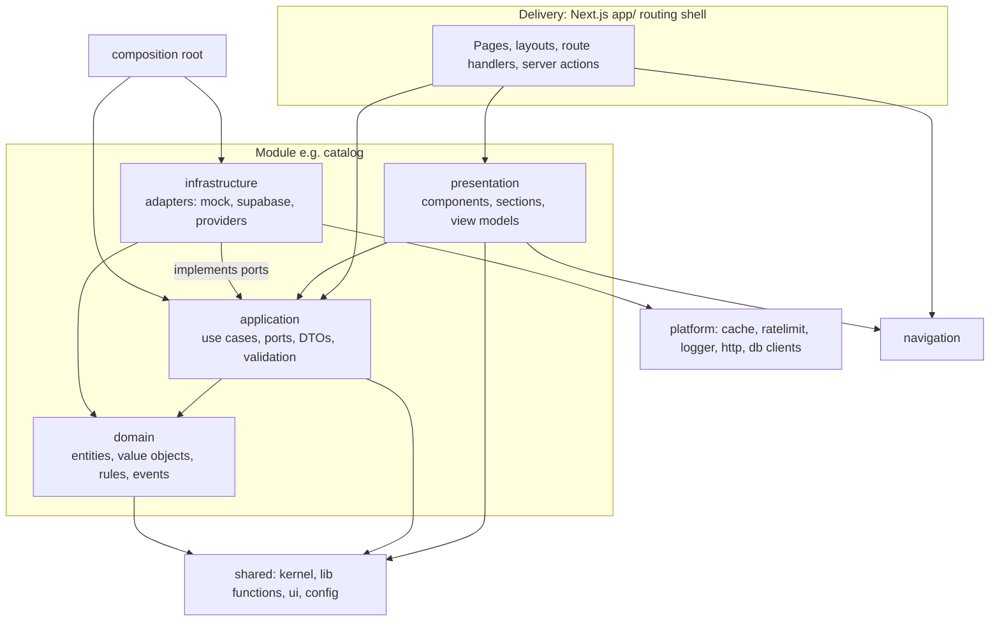
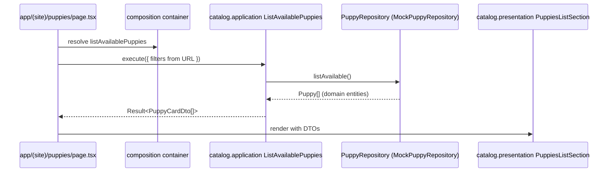

# 21. Modular Monolith Architecture and Project Structure

| | |
|---|---|
| **Status** | Draft, awaiting review |
| **Version** | 0.1 |
| **Date** | 2026-11-02 |
| **Decision** | Owner, 2026-11-02: the system is a **modular monolith** with an enterprise project structure (domain, business logic, functions, navigation and so on) |
| **Supersedes** | The flat `lib/` and `components/` layout in the first draft of `04` section 3 |
| **Related** | `04` (containers, flows), `05` (data), `07` (RBAC), `13` (public spec), `15` (tests), `17` (roadmap), `20` (mock data), `16` ADR-015 |

## 1. Decision and intent

One deployable application (Next.js on Vercel) organised as **independent business modules** with strict boundaries. Each module is a bounded context with its own domain model, business logic, infrastructure adapters and UI. Modules talk to each other only through small public APIs or domain events. The structure lets the frontend ship first on mock data and lets each backend capability (billing, messaging, identity, commerce) be added later as a new module without touching the others, and leaves a clean path to extract a module into a separate service if ever needed.

**How I read the owner's words.** "Domain / business logic / function / navigation etc." is interpreted as:

| Owner's term | Meaning here | Where it lives |
|---|---|---|
| Domain | Entities, value objects, domain rules, domain events | `modules/<m>/domain` |
| Business logic | Use cases (commands and queries), policies, orchestration, validation at the boundary | `modules/<m>/application` |
| Functions | Pure, stateless helper functions (formatting, slug, phone, money, date, text) | `shared/lib` (and pure functions inside `domain`) |
| Navigation | Route registry, menus, breadcrumbs, guards, link builders, metadata mapping | `navigation/` |
| "etc." | Infrastructure adapters, presentation, shared UI/design system, composition root, cross-cutting platform services, configuration | `modules/<m>/infrastructure`, `modules/<m>/presentation`, `shared/ui`, `composition/`, `platform/`, `shared/config` |

If "functions" was meant differently (for example serverless functions or a per-feature "functions" folder), say so at review; the mapping above is the only assumption in this document that rests on interpretation (see Open questions).

## 2. Architectural style

- **Modular monolith**: a single codebase, build and deployment, with enforced module boundaries (not a distributed system).
- **Layered, ports-and-adapters (clean/hexagonal) inside each module**: dependencies point inward toward the domain.
- **Thin delivery layer**: the Next.js `app/` folder only routes requests to module presentation and use cases.
- **Composition root**: a single place wires ports to adapters (mock now, Supabase later), selected by configuration.



## 3. Module catalogue

| Module | Bounded context | Owns (domain) | Main use cases | Depends on (public APIs) | Track |
|---|---|---|---|---|---|
| `catalog` | Puppies and their media | Puppy, MediaItem, Breed, Origin, status (available, reserved, gone home), filters | ListAvailable, ListGoneHome, GetPuppyDetail, FilterPuppies, Neighbours | none | **Frontend** |
| `content` | Editorial and site content | Family photo, Faq, Testimonial, SiteSettings, static page content (how it works, journey, trust points) | ListFamilies, ListFaqs, SearchFaqs, GetSettings, GetTestimonial | none | **Frontend** |
| `crm` | Customer relationships and customer privacy | Enquiry, Customer, EnquiryNote, ConsentRecord, DataSubjectRequest | SubmitEnquiry (mock now), ListEnquiries, ConvertEnquiry, UpsertCustomer | `catalog` (puppy reference) | Frontend (submit only); full later |
| `storefront` | Public experience composition | none (presentation only): header, footer, scenes, page compositions, mascot, curtain | Compose pages from other modules' public presentation APIs | `catalog`, `content`, `crm`, `navigation` | **Frontend** |
| `assistant` (planned, AI track, documents `26` to `30`) | Public puppy assistant: conversations, retrieval policy, guard, feedback, learned policy artifacts | Conversation, Message, ToolCall, Feedback, PolicyAction, Reward, versions | SendMessage (streamed), RecordFeedback, DeleteConversation, ExportConversation | `catalog`, `content`, `crm` (public APIs; knowledge export and draft links only) | **AI track** (not built) |
| `commerce` | Orders and delivery | Order, OrderItem, Delivery, DeliveryEvent, state machines | CreateOrder, TransitionOrder, RecordDeliveryEvent | `crm`, `catalog`, `messaging` (events) | Backend |
| `billing` | Money | Payment, Refund, Invoice, TaxRate, gateways | RecordPayment, RequestRefund, IssueInvoice, VoidInvoice | `commerce` | Backend |
| `messaging` | Communications | Template, NotificationRule, Message, InboundMessage, Notification, Outbox | RenderTemplate, SendMessage, ProcessOutbox, ListNotifications | `crm` (recipients) | Backend |
| `identity` | Access control | Profile, Role, Permission, Session policy, AuditEntry | InviteUser, SignIn, ResetPassword, CheckPermission, WriteAudit | none | Backend |
| `backoffice` | Admin UI composition | none (presentation only): admin shell, dashboard, module admin screens | Compose admin pages from modules' admin presentation | all modules | Backend |

Rules for the catalogue:
- A module owns its data. No other module reads or writes its tables or fixtures directly (see `05` section 9b for table ownership).
- `storefront` and `backoffice` are **presentation-only modules**; they hold no domain or persistence.
- `assistant` is the only module that `storefront` may embed beyond the frontend modules; nothing depends on `assistant` except `storefront` (presentation) and its own route handlers, so the graph stays acyclic.
- The frontend track builds `catalog`, `content`, the submit slice of `crm`, `storefront`, and the shared layers. The other modules are **not created** until their phase (empty folders are not committed).

## 4. Standard module anatomy

Every module has the same shape. Example for `catalog`:

```
modules/catalog/
├─ domain/                         # pure TypeScript, no framework, no I/O
│  ├─ entities/                    # Puppy.ts, MediaItem.ts
│  ├─ value-objects/               # Slug.ts, AgeText.ts, PuppyStatus.ts, Origin.ts, BreedRef.ts
│  ├─ services/                    # PuppyFilterPolicy.ts, NeighbourResolver.ts (domain rules)
│  ├─ events/                      # PuppyMarkedGoneHome.ts
│  ├─ errors/                      # PuppyNotFound.ts, InvalidTransition.ts
│  └─ index.ts                     # domain barrel (types used by application and presentation)
├─ application/                    # business logic
│  ├─ ports/                       # PuppyRepository.ts, MediaUrlResolver.ts (interfaces)
│  ├─ use-cases/                   # ListAvailablePuppies.ts, GetPuppyDetail.ts, FilterPuppies.ts
│  ├─ dto/                         # PuppyCardDto.ts, PuppyDetailDto.ts (read models)
│  ├─ mappers/                     # domain → DTO
│  ├─ validation/                  # Zod schemas for inputs (filter query, etc.)
│  └─ index.ts
├─ infrastructure/                 # adapters, one folder per technology
│  ├─ mock/                        # fixtures/*.json, MockPuppyRepository.ts (frontend track)
│  ├─ supabase/                    # SupabasePuppyRepository.ts, row mappers (backend track)
│  └─ media/                       # PlaceholderMediaResolver.ts
├─ presentation/                   # UI for this module
│  ├─ components/                  # PuppyCard, FilterPad, Gallery, InfoCard
│  ├─ sections/                    # PuppiesListSection, PuppyDetailSection
│  ├─ hooks/                       # usePuppyFilters (client state, URL sync)
│  ├─ view-models/                 # presentation-only shaping of DTOs
│  └─ index.ts
├─ module.config.ts                # module id, routes, nav items, permissions, events (see section 8)
├─ index.ts                        # PUBLIC API: the only file other modules may import
└─ README.md                       # purpose, use cases, events, owner
```

### 4.1 What each layer may contain

| Layer | Contains | Must not contain |
|---|---|---|
| **domain** | Entities, value objects, invariants, state machines, domain services, domain events, domain errors, pure functions about the business | React, Next.js, Zod, fetch, Supabase, env, dates from the system clock (use `Clock`), randomness (use `IdGenerator`) |
| **application** | Use cases (one class or function per command or query), ports (interfaces for repositories, gateways, clock, event bus), DTOs, mappers, input validation schemas, permission policy checks, orchestration and transactions | UI, framework APIs, SQL, SDK calls |
| **infrastructure** | Adapters implementing ports: mock fixtures, Supabase repositories, provider SDK wrappers (Resend, WhatsApp, Stripe, Razorpay), row mappers | Business rules (they belong in domain or application) |
| **presentation** | React components, sections, hooks, view models, page compositions for the module, client-side state | Direct data access, SDK calls, business rules, imports of `infrastructure` |

## 5. Top-level source tree

```
src/
├─ app/                            # Next.js App Router: ROUTING SHELL ONLY
│  ├─ (site)/                      # public routes; each page.tsx is ~10 to 30 lines
│  │  ├─ layout.tsx  page.tsx  not-found.tsx
│  │  ├─ puppies/page.tsx  puppies/[slug]/page.tsx
│  │  ├─ gone-home/  happy-families/  how-it-works/  faq/  contact/
│  ├─ (admin)/admin/…              # backend track
│  └─ api/                         # thin route handlers → module use cases (public enquiry, webhooks, cron)
├─ modules/                        # business modules (section 3)
│  ├─ catalog/  content/  crm/  storefront/        # frontend track
│  └─ commerce/  billing/  messaging/  identity/  backoffice/   # backend track
├─ shared/                         # no business knowledge
│  ├─ kernel/                      # Result, AppError, Id, Clock, Money, DomainEvent, Specification
│  ├─ lib/                         # pure functions: format, slug, phone (E.164), date, text, array
│  ├─ ui/                          # design system: tokens, primitives (Button, Chip, Tag, Card), patterns, icons
│  └─ config/                      # env schema (Zod), feature flags, constants
├─ navigation/                     # route registry, menus, breadcrumbs, guards, link builders, metadata
├─ platform/                       # cross-cutting technical services
│  ├─ http/  cache/  ratelimit/  logger/  events/  storage/  db/  security/
├─ composition/                    # composition root: container, module registry, bootstrap
└─ middleware.ts                   # edge middleware: admin gate, rate limits, headers
tests/
├─ architecture/                   # dependency and layering rules
├─ e2e/                            # Playwright
└─ fixtures/                       # shared test data builders
scripts/                           # one-off tools (extract-fixtures)
supabase/                          # migrations, seed, SQL tests (backend track)
docs/  docs/05-research/  docs/04-design-ux/reference-analysis/
```

Path aliases (single source in `tsconfig`): `@modules/*`, `@shared/*`, `@platform/*`, `@nav/*`, `@composition/*`. Relative imports never cross a module root.

## 6. Dependency rules

Allowed imports (`✔`); everything else is forbidden.

| From ↓ / To → | domain | application | infrastructure | presentation | other module's public API | shared | platform | navigation | composition |
|---|---|---|---|---|---|---|---|---|---|
| `modules/x/domain` | own | | | | | kernel, lib | | | |
| `modules/x/application` | ✔ | own | | | ✔ (via declared port) | ✔ | | | |
| `modules/x/infrastructure` | ✔ | ✔ (ports) | own | | ✔ | ✔ | ✔ | | |
| `modules/x/presentation` | ✔ (types) | ✔ (use cases, DTOs) | | own | ✔ (components) | ✔ (incl. ui) | | ✔ (links) | |
| `app/` | | ✔ (via module index) | | ✔ (via module index) | ✔ | ✔ | | ✔ | ✔ |
| `navigation/` | | | | | module.config only | ✔ | | own | |
| `platform/` | | | | | | ✔ | own | | |
| `shared/` | | | | | | own | | | |
| `composition/` | ✔ | ✔ | ✔ | | ✔ | ✔ | ✔ | ✔ | own |

Hard rules:
1. **The dependency arrow points inward.** Nothing in `domain` imports `application`, `infrastructure` or `presentation`.
2. **Modules never import another module's internals.** Cross-module access is only through the other module's `index.ts` (public API) or domain events. Deep imports such as `@modules/catalog/domain/entities/Puppy` from outside `catalog` are forbidden.
3. **No cycles** between modules (the dependency graph in section 3 must stay a DAG).
4. **`shared` never imports a module** and contains no business concepts.
5. **`presentation` never imports `infrastructure`.** Data arrives via use cases from the composition root.
6. **`app/` pages contain no business logic**: they resolve a use case from the container, call it, and render a module section.
7. A module's `index.ts` exports only: its use-case facade, DTO types, presentation sections it wants others to embed, and its `moduleDefinition`.

### 6.1 Enforcement

| Mechanism | What it checks |
|---|---|
| TypeScript path aliases | Prevents ad hoc relative reaches across modules |
| ESLint boundaries rules (for example `eslint-plugin-boundaries` or `no-restricted-imports`) | Layer and module import matrix above, on every lint run |
| `dependency-cruiser` rules (or similar) | No cycles, no orphans, forbidden paths; graph artefact in CI |
| `tests/architecture/*.test.ts` | Programmatic checks: domain has no framework imports; each module has an `index.ts`; `app/` pages under a line limit; no `infrastructure` import from `presentation` |
| Code review checklist (section 12) | Items tools cannot check |

Tool names are proposals; the choice is confirmed in the setup phase (F0). The rules themselves are the requirement.

## 7. Inter-module communication

| Need | Mechanism | Example |
|---|---|---|
| Ask another module for data | Call its **public API** (query facade) | `crm` shows the puppy name for an enquiry through `catalog.getPuppySummary(id)` |
| Notify other modules that something happened | **Domain event** on an in-process event bus (`platform/events`), later persisted through the transactional outbox | `commerce` emits `OrderConfirmed`; `messaging` reacts and sends a message |
| Share a concept | Duplicate a small read model in the consumer (anti-corruption mapping), not the producer's entity | `crm` stores `puppyId` and a snapshot name |
| Cross-module transaction | Avoid; if unavoidable use one application service that orchestrates and a single unit of work | `billing.RecordPayment` updates order status through `commerce`'s public command |
| UI embedding | Import another module's **presentation API** from its `index.ts` | `storefront` embeds `catalog`'s `PuppyGrid` section |

Events are typed, immutable, named in the past tense and versioned when they leave the process. In the frontend track the bus is in-memory and mostly unused.

## 8. Navigation architecture

`navigation/` is the single source of truth for routes, menus and links. It contains no UI.

```
navigation/
├─ routes.ts            # typed route registry: id, path pattern, params, access (public|auth|permission), meta
├─ paths.ts             # type-safe link builders: paths.puppy(slug), paths.puppies({breed, origin})
├─ menus.ts             # header, mobile menu, footer Explore, bottom bar, admin sidebar (built from module configs + overrides)
├─ breadcrumbs.ts       # trail builders per route
├─ guards.ts            # route guards: requireAuth, requirePermission(key), noindexAdmin
├─ metadata.ts          # maps route ids to page metadata (public SEO) and to noindex (admin)
├─ sitemap.ts           # sitemap and robots built from public routes only; admin never listed
└─ index.ts
```

- **Modules contribute**: each module's `module.config.ts` declares its routes, nav items (label, order, area `site` or `admin`), permission keys and event names. `composition/` collects them into the registry at build time; `navigation` merges and orders them.
- **Type safety**: all links are created through `paths.*`; raw string URLs are forbidden by lint (`no-restricted-syntax` on `href="/..."` outside `navigation`).
- **Public vs admin**: routes carry `area: 'site' | 'admin'`. Admin routes get `noindex` metadata, no SEO fields, no sitemap entry and are never rendered in public menus (`06` section 2).
- **Guards** run in two places: `middleware.ts` (cheap checks, redirects) and server components/actions (authoritative, via `identity` application policies and RLS later).
- **Active-link and breadcrumb logic** derives from the registry, not from string matching in components.
- **Frontend-track nav**: header links Home, Puppies, Happy families, How it works, FAQ, Visit & contact; footer Explore (including Delivery & collection anchor); bottom bar; mobile menu. Order and labels as in `docs/04-design-ux/reference-analysis/`.

Example route entry (illustrative):

```ts
{ id: 'puppy.detail', path: '/puppies/[slug]', area: 'site', access: 'public',
  breadcrumb: (p) => [paths.puppies(), p.puppyName], module: 'catalog' }
```

## 9. Business logic conventions (application layer)

- **One use case per file**; a use case is a function or class with a single `execute(input)` that returns `Result<Output, AppError>`.
- **Commands** change state; **queries** only read. Names are verbs: `SubmitEnquiry`, `GetPuppyDetail`.
- **Validation at the boundary**: inputs are parsed with Zod schemas in `application/validation`; the same schema is exported for client-side form hints. Domain objects are constructed only from valid data.
- **Errors**: a small taxonomy in `shared/kernel` (`ValidationError`, `NotFound`, `Forbidden`, `Conflict`, `RateLimited`, `Unexpected`); use cases return typed errors, delivery maps them to HTTP or UI messages (`08` error envelope).
- **Permissions**: use cases that need authorisation call an `AccessPolicy` port (implemented by `identity`); never read the session directly.
- **Transactions**: a `UnitOfWork` port in the backend track; mock adapters implement it trivially.
- **Time and ids** come from `Clock` and `IdGenerator` ports for deterministic tests.
- **Personal data:** every module that stores personal data implements the `PersonalDataProvider` port from `shared/kernel` (`describe()`, `export(subject)`, `anonymise(subject)`); the composition root aggregates providers so data subject requests, retention and erasure (`06` section 6.6) work across modules. A module without it fails the architecture tests.
- **Pure functions first**: filtering, sorting, neighbour lookup and state transitions are pure functions in `domain` or `shared/lib` and unit tested.

## 10. Functions (pure helpers)

`shared/lib` holds stateless, side-effect-free functions with no imports from modules:

| Group | Examples |
|---|---|
| format | `formatMoney`, `formatAge`, `pluralize` |
| slug and text | `slugify`, `truncate`, `normalizeWhitespace` |
| phone and contact | `normalizePhoneE164`, `buildWhatsAppUrl`, `buildTelUrl` |
| date and time | `formatDate`, `isQuietHour` (takes a clock value, never reads the system clock) |
| array and object | `groupBy`, `uniqueBy`, `clamp` |
| url | `withQuery`, `parseQuery` (used by `navigation/paths`) |

Rules: pure, deterministic, fully unit tested, no `any`, no global state. Business-specific pure functions (for example `isValidTransition`) live in the owning module's `domain`.

## 11. Composition root and configuration

- `composition/container.ts` builds the object graph once per process (and per request where needed) by selecting adapters from configuration: `DATA_SOURCE=mock|supabase`, `EMAIL_PROVIDER`, `WHATSAPP_PROVIDER`, `PAYMENT_GATEWAYS` (`14`).
- `composition/modules.ts` registers every module's `moduleDefinition` (routes, permissions, events); modules not yet built are simply absent.
- Pages and handlers obtain use cases from the container (`getContainer().catalog.listAvailablePuppies`), never construct adapters.
- Tests build their own container with fakes.
- Environment is read only in `shared/config` (validated once); no other file reads `process.env`.

## 12. Presentation and delivery rules

- **Design system** lives in `shared/ui` (tokens from `docs/04-design-ux/reference-analysis/visual-design-analysis.md`, primitives, patterns, icons, motion helpers). Module `presentation` composes it into feature components.
- **Server components by default**; client components only for interactivity (filters, gallery, lightbox, toggle, forms, scroll effects). Client components receive plain DTO props.
- **`app/` files** stay thin: resolve use case, call it, pass DTOs to a module section, export metadata from `navigation/metadata`.
- **Route handlers and server actions** parse input with the module's schema, call a use case, map the `Result` to a response; no logic inline.
- **Styling**: Tailwind with tokens; no module defines its own colours or fonts.
- **No data fetching in components** below the page level except through the page's use-case results.

## 13. Cross-cutting (platform)

| Concern | Home | Notes |
|---|---|---|
| Logging, request ids | `platform/logger` | Structured; no PII |
| Cache and revalidation | `platform/cache` | Tag helpers used by infrastructure adapters (backend track) |
| Rate limiting | `platform/ratelimit` | Named limiters (`08` section 4); used by delivery and `crm`/`identity` entry points |
| Events | `platform/events` | In-process bus; outbox adapter later |
| HTTP and webhook helpers | `platform/http` | Error envelope mapping, signature utilities |
| Security headers, CSRF, IP hashing | `platform/security` | |
| DB and storage clients | `platform/db`, `platform/storage` | Supabase factories (server-only), backend track |

## 14. Request flows in the modular structure

### 14.1 `GET /puppies` (frontend track)



### 14.2 Enquiry submit (frontend track, mock; backend later)

`ContactLetterForm` (crm.presentation) → server action or `/api/public/enquiry` (app, thin) → `crm.application.SubmitEnquiry` (validate with schema, rate-limit port, create `Enquiry`) → `EnquiryRepository` (mock: returns success after a short delay; Supabase later calls `create_enquiry`) → emits `EnquirySubmitted` event (later consumed by `messaging`).

## 15. Mapping from the first-draft layout to modules

| Earlier path (docs 04, 08, 10, 11, 13, 14, 16, 17, 20) | New home |
|---|---|
| `src/lib/data/types.ts`, `repositories.ts` | `modules/<m>/domain` (types) and `modules/<m>/application/ports` (interfaces) |
| `src/lib/data/mock/*` | `modules/<m>/infrastructure/mock/` |
| `src/lib/data/*` cached readers (Supabase) | `modules/<m>/infrastructure/supabase/` (+ `platform/cache`) |
| `src/lib/validation/*` | `modules/<m>/application/validation/` |
| `src/lib/env.ts` | `shared/config/env.ts` |
| `src/lib/auth/*` | `modules/identity/` (application policies, infrastructure session adapters) |
| `src/lib/ratelimit/*` | `platform/ratelimit/` |
| `src/lib/payments/*` | `modules/billing/infrastructure/gateways/` (+ `application/ports/PaymentGateway.ts`) |
| `src/lib/messaging/*` | `modules/messaging/` (domain templates and rules, application use cases, infrastructure providers) |
| `src/lib/supabase/*` | `platform/db/` |
| `src/lib/audit`, `money`, `logger` | `modules/identity` (audit), `shared/kernel/Money`, `platform/logger` |
| `src/components/ui` | `shared/ui` |
| `src/components/site`, `admin` | `modules/storefront/presentation`, `modules/backoffice/presentation` and each module's `presentation` |
| `src/content/*` (static copy) | `modules/content/infrastructure/static/` (typed static content provider) |
| `middleware.ts` | `src/middleware.ts` (unchanged), using `platform/security` and `navigation/guards` |

## 16. Testing per layer

| Layer | Test type | Notes |
|---|---|---|
| `shared/lib`, `domain` | Unit tests, pure, fast, no mocks | Property tests where useful |
| `application` | Unit tests with fake ports and in-memory repositories | One test file per use case |
| `infrastructure/mock` | Contract tests shared with the Supabase adapter | The same suite runs against both adapters later |
| `infrastructure/supabase` | Integration and SQL tests (backend track) | RLS suite (`07`) |
| `presentation` | Component tests (Testing Library) | Props in, DOM out |
| `navigation` | Unit tests: registry integrity, link builders, breadcrumbs, sitemap excludes admin | |
| `app/` | End to end (Playwright) | Page journeys |
| Architecture | `tests/architecture` | Dependency rules (section 6.1) |

## 17. Governance

### 17.1 Adding a module (checklist)

1. Create the module folder with the four layers, `module.config.ts`, `index.ts`, `README.md`.
2. Declare owned entities, use cases, events and permission keys; update section 3 and `05` section 9b.
3. Implement domain and application first with fake adapters and tests.
4. Add infrastructure adapters; register in `composition`.
5. Add presentation and routes; register routes in `module.config.ts`.
6. Pass architecture tests; add an ADR if a rule is bent.

### 17.2 Definition of done for a module change

Layer rules respected; public API unchanged or versioned; tests at each touched layer; docs updated (this file for structure, `05` for data); no new dependency cycle; no cross-module deep import.

### 17.3 Review checklist (beyond tools)

**Privacy impact (new field, purpose, vendor or retention? update `06` 6.4 and 6.8);** business rule in the right layer; use case names describe intent; DTOs expose only what the UI needs; no leaking of entities to presentation across module lines; naming consistent; no duplicate helper functions (check `shared/lib` first).

### 17.4 Conventions

Files: `PascalCase` for classes and components, `camelCase` for functions, `kebab-case` for folders; one exported primary symbol per file; named exports (no default exports except where Next.js requires, such as `page.tsx`); barrels only at `index.ts` of module, layer root and `shared` areas; TypeScript `strict`; no `any`; ADRs in `16`.

## 18. Frontend-first mapping

| Item | In the frontend track |
|---|---|
| Modules created | `catalog`, `content`, `crm` (SubmitEnquiry slice), `storefront` |
| Shared | `kernel`, `lib`, `ui`, `config` |
| Navigation | Full registry for public routes; admin routes absent |
| Platform | `logger`, `events` (in-memory), `ratelimit` interface with a no-op or in-memory adapter for the mock form |
| Composition | `DATA_SOURCE=mock` only |
| Infrastructure | `mock` adapters and `static` content only |
| Not created | `commerce`, `billing`, `messaging`, `identity`, `backoffice`, `supabase` adapters, `(admin)` routes, `supabase/` folder |

Moving to the backend track adds the Supabase adapters to existing modules, then creates the remaining modules one by one in the order in `17` section 0.2.

## 19. Risks of this style and mitigations

| Risk | Mitigation |
|---|---|
| Over-engineering for a 48-hour clone | Frontend track builds only four modules and thin layers; each layer file is small; empty layers are not created; boundaries enforced by tooling rather than by ceremony |
| Boundary rules slow early coding | Aliases and lint rules set up once in F0; templates (`scripts/new-module`) optional later |
| Mapping overhead (entity to DTO to view model) | Keep DTOs flat; skip view models where DTOs already fit the UI |
| Divergence between mock and Supabase adapters | Shared contract test suite (section 16) |
| Developers bypass the public API | Lint and architecture tests fail the build |

## Open questions

1. Is "functions" the pure helper library (assumed), or something else (for example serverless functions)?
2. Confirm tooling for boundary enforcement (`eslint-plugin-boundaries` and `dependency-cruiser`) or prefer another.
3. Should `storefront` and `backoffice` stay separate presentation modules (assumed) or be folded into each domain module's presentation?
4. Is a module generator script wanted in F0, or add it only when the second backend module starts?
5. Any naming preferences (`modules` vs `features`, `application` vs `services`) from the owner's usual standard?
