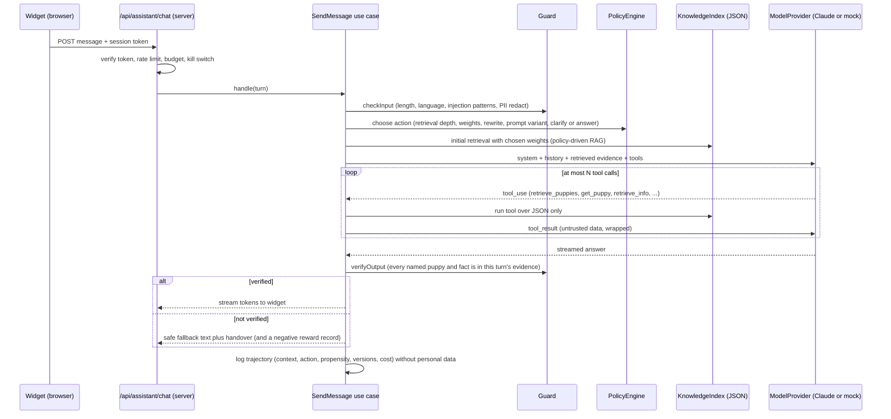

# 27. AI Assistant: Architecture and Tools

| | |
|---|---|
| **Status** | Draft, awaiting owner review. **No code, packages or keys until approved** |
| **Version** | 0.1 |
| **Date** | 2026-11-02 |
| **Related** | `26` (product), `28` (safety and data), `29` (learning and evaluation), `30` (plan), `21` (modular monolith rules), `04`, `14`, `06` section 6 |

Code in this document is design notation (TypeScript-style signatures), not implementation. Anything about the external model API is marked **verify** and must be re-checked against current Anthropic documentation when building.

## 1. Goals and constraints

1. A **RAG agent**: it retrieves from our own **generated JSON knowledge files only**, then answers. No internet, no web tools, no database or admin access, no tool that changes anything except returning a draft message.
2. A **learned policy layer** (`29`) chooses how retrieval and the prompt are configured per turn; the Claude model underneath stays frozen.
3. Follow `21`: new module with four layers, public APIs between modules, no raw `process.env` outside `shared/config`, thin `app/` files, `presentation` never imports `infrastructure`, no cycles.
4. **Mock mode** for tests, demos and CI: identical code path, deterministic scripted model, no network.
5. Model keys never reach the browser; one allowed outbound call (the model API host).

## 2. Module placement

| Module | Bounded context | Depends on (public APIs) | Used by |
|---|---|---|---|
| `assistant` (new) | Conversations, retrieval policy, guard, feedback, learning artifacts | `catalog` (puppy facts for knowledge export and slugs), `content` (FAQs, copy, settings), `crm` (enquiry draft helper only; never submits) | `storefront` (embeds the widget), `app/api/assistant/*` |

The dependency graph stays acyclic: nothing depends on `assistant` except `storefront` (presentation) and the route handlers. Add the row to the module catalogue in `21` section 3 (docs only now). Tables, when persistence arrives, are owned by `assistant` (see `05` section 9b addition).

## 3. Layers and files (target layout)

```
app/src/modules/assistant/
  index.ts                     public API: use-case facade, ChatWidget, moduleDefinition
  module.config.ts  README.md
  domain/                      Conversation, Message, ToolCall, RetrievalResult, Feedback, PolicyAction, Reward, PromptVersion, KnowledgeVersion
  application/
    ports/                     ModelProvider, KnowledgeIndex, ToolSet, ConversationStore, FeedbackStore, PolicyStore, Guard (also RateLimiter, Clock, IdGenerator from shared/crm)
    usecases/                  StartConversation, SendMessage (streams), RecordFeedback, HandOver, DeleteConversation, ExportConversation
    policy/                    PolicyEngine (choose action), RewardFunction, FeatureExtractor
    validation/                Zod schemas for requests and tool IO
  infrastructure/
    anthropic/                 AnthropicModelProvider (only place the SDK is imported)
    mock/                      ScriptedModelProvider, InMemory stores, deterministic ids
    knowledge/                 JsonKnowledgeIndex (reads knowledge/vN/*.json, BM25 and filters)
    tools/                     tool adapters (call knowledge index and crm helper; no network)
    supabase/                  stores (backend track)
  presentation/                ChatWidget (client island), MessageList, PuppyCard, FeedbackBar, assistant.css
app/src/app/api/assistant/chat/route.ts       thin streaming route handler (SSE)
app/src/app/api/assistant/feedback/route.ts   thin
app/src/modules/assistant/infrastructure/knowledge/vN/*.json   generated, read-only, versioned (inside the module so imports stay legal)
app/scripts/build-knowledge.mjs                generator (same pattern as build-fixtures.mjs)
```

## 4. Ports (contracts)

```ts
interface ModelProvider {                       // implemented by anthropic/ and mock/
  stream(req: ModelRequest): AsyncIterable<ModelEvent>;   // text deltas, tool_use, usage, stop
}
interface ModelRequest {
  system: SystemBlock[];                        // cached prefix first, volatile parts last
  messages: ModelMessage[];
  tools: ToolDefinition[];                      // allow-list only; web/code tools are never declared
  maxOutputTokens: number;
  budget: { maxToolCalls: number };
}
type ModelEvent =
  | { type: 'text'; delta: string }
  | { type: 'tool_use'; id: string; name: ToolName; input: unknown }
  | { type: 'usage'; inputTokens: number; outputTokens: number; cacheReadTokens: number; cacheWriteTokens: number }
  | { type: 'stop'; reason: 'end' | 'max_tokens' | 'refusal' | 'error' };

interface KnowledgeIndex {                      // JSON files only
  version(): KnowledgeVersion;
  puppies(filter: PuppyQuery, weights: RankingWeights, limit: number): PuppyHit[];
  puppy(slug: string): PuppyDoc | undefined;
  info(query: string, weights: RankingWeights, limit: number): InfoHit[];
  contact(): ContactOptions;
}
interface ToolSet { definitions(): ToolDefinition[]; run(call: ToolCall, ctx: TurnContext): Promise<ToolResult>; }
interface Guard { checkInput(text: string): InputVerdict; verifyOutput(answer: string, evidence: Evidence[]): OutputVerdict; redact(text: string): string; }
interface ConversationStore { /* append message, load window, delete by id, expire */ }
interface FeedbackStore  { /* append feedback and trajectory records; query for training */ }
interface PolicyStore    { /* active policy artifact, candidates, history, rollback */ }
```

Existing ports reused: `RateLimiter` (`crm/application/ports.ts` pattern; a limiter port also lives in the shared kernel once the backend track adds Upstash), `Clock` and `IdGenerator` (`shared/kernel/ports.ts`), `PersonalDataProvider` (same file, see `28`).

## 5. A turn, end to end



Notes:
- **Streaming and verification:** to avoid showing an unverified claim, the server buffers the answer in short segments (sentence by sentence), verifies each segment against evidence, and only then streams it; unverifiable segments are replaced with the fallback. Typical added latency is small (sentence granularity); measured in `30` (AC-AST-06).
- **Policy-driven RAG:** the policy chooses retrieval before the model call (top-k, weights, rewrite) so the model starts with relevant evidence; the model may still call tools for more. Tool defaults (top-k, weights) also come from the policy action for that turn.
- **Single-writer rule:** only `SendMessage` writes conversation records, so ordering is deterministic.

## 6. Knowledge base: generated JSON files

Generated by `app/scripts/build-knowledge.mjs` from the owning modules' **public APIs** (today the mock fixtures through `catalog` and `content`; later the Supabase-backed repositories on content publish). Output is versioned, immutable and read-only at runtime.

```
app/src/modules/assistant/infrastructure/knowledge/v1/
  manifest.json        { version, generatedAt, source: "mock"|"supabase", counts, sha256 per file }
  puppies.json         PuppyDoc[]
  gone-home.json       PuppyDoc[] (status "gone-home"; used only to say a puppy has gone home)
  faqs.json            { id, question, answer }[]
  info.json            { id, topic, title, text }[]    // how-it-works copy, delivery and health text, split into short chunks
  settings.json        { whatsappUrl, phoneDisplay, email, address, mapsUrl, instagram, tiktok }
```

```ts
interface PuppyDoc {
  id: string; slug: string; name: string; hasPersonalName: boolean;
  breed: string; breeds: string[]; sex: 'male' | 'female' | 'male-female';
  age: string; colour?: string; where: string; origin: 'local' | 'imported';
  collections: string[]; status: 'available' | 'gone-home';
  hasVideo: boolean; pageUrl: string; coverImageUrl?: string; text: string; // short searchable summary
}
```

Rules: public fields only (the same ones the site shows); **no prices**, no internal notes, no contact data of customers; every document has a stable `id` used as the evidence id; the generator fails if a document contains an email address or phone number other than the business contact in `settings.json`.

## 7. Retrieval (local and deterministic)

| Need | Method |
|---|---|
| Puppies by attributes | Structured filter first, reusing `catalog`'s semantics (AND between groups, breed and sex single choice, pair matches both sexes, origin, Korean Teacup collection), then rank |
| Free text over FAQs and copy | Lexical **BM25** over `info.json` and `faqs.json` (small corpus, no embeddings needed at launch) |
| Mixed query | Intent classifier (rules first) splits into filter terms and free text |
| Ranking weights | `w_filter`, `w_bm25`, `w_availability`, `w_recency` from the policy action; defaults in the prompt release |
| Embeddings | Optional, **local model only** (nothing external); not used at launch (decision D33); if added, the index stays JSON plus a vector file |

Every hit returns `{ id, kind, score, snippet }`; the id list becomes the turn's **evidence**.

## 8. Tool catalogue

All tools are read-only except `create_enquiry_draft`, which only returns text and links. Inputs and outputs are Zod schemas in `application/validation/`; the model API tool definitions are generated from them. Tool results are wrapped as untrusted data (`28` section 4). Each tool has a hard cap on result size (about 2,000 tokens).

| Tool | Purpose | Module API behind it | Mutates? |
|---|---|---|---|
| `retrieve_puppies` | Find available puppies by attributes | `JsonKnowledgeIndex.puppies` (knowledge generated from `catalog` public API) | No |
| `get_puppy` | Facts for one puppy by slug | `JsonKnowledgeIndex.puppy` | No |
| `retrieve_info` | Search FAQs, delivery, health and process text | `JsonKnowledgeIndex.info` (from `content`) | No |
| `get_contact_options` | WhatsApp, phone, email, address for handover | `JsonKnowledgeIndex.contact` (from `content` settings) | No |
| `create_enquiry_draft` | Pre-filled message plus deep links; never submits | builds links via `navigation` and settings; uses `crm` validation limits for message length | No (returns text) |

```ts
// retrieve_puppies
const RetrievePuppiesInput = z.object({
  breed: z.enum(['maltipoo','pomeranian','poodle','cavapoo','shih-tzu']).optional(),
  sex: z.enum(['male','female']).optional(),                 // pair entries match both
  origin: z.enum(['local','imported']).optional(),
  collection: z.literal('korean-teacup').optional(),
  text: z.string().max(200).optional(),                       // free-text hint
  limit: z.number().int().min(1).max(8).default(5),
}).strict();
const PuppyHit = z.object({ id: z.string(), slug: z.string(), name: z.string(), breed: z.string(),
  sex: z.string(), age: z.string(), origin: z.string(), status: z.literal('available'),
  pageUrl: z.string(), hasVideo: z.boolean() }).strict();
const RetrievePuppiesOutput = z.object({ evidenceIds: z.array(z.string()), total: z.number(), hits: z.array(PuppyHit) }).strict();

// get_puppy
const GetPuppyInput = z.object({ slug: z.string().regex(/^[a-z0-9-]{1,80}$/) }).strict();
const GetPuppyOutput = z.object({ found: z.boolean(), evidenceIds: z.array(z.string()),
  puppy: PuppyDoc.optional(), note: z.string().optional() /* e.g. "gone home" */ }).strict();

// retrieve_info
const RetrieveInfoInput = z.object({ query: z.string().min(2).max(200),
  topic: z.enum(['delivery','health','process','visit','imports','general']).optional(), limit: z.number().int().min(1).max(5).default(3) }).strict();
const RetrieveInfoOutput = z.object({ evidenceIds: z.array(z.string()),
  hits: z.array(z.object({ id: z.string(), kind: z.enum(['faq','info']), title: z.string(), text: z.string() })) }).strict();

// get_contact_options
const GetContactOptionsInput = z.object({}).strict();
const GetContactOptionsOutput = z.object({ evidenceIds: z.array(z.string()),
  whatsappUrl: z.string(), contactFormUrl: z.string(), phoneDisplay: z.string(), email: z.string() }).strict();

// create_enquiry_draft
const CreateEnquiryDraftInput = z.object({ puppySlug: z.string().optional(),
  summary: z.string().min(3).max(400) /* what the visitor wants, no personal data */ }).strict();
const CreateEnquiryDraftOutput = z.object({ message: z.string().max(600), whatsappLink: z.string(),
  formLink: z.string(), evidenceIds: z.array(z.string()) }).strict();
```

Validation rules: unknown fields are rejected (`strict`); the model's tool input is validated before running, a validation failure is returned to the model as an error result (never run with guessed values); phone- or email-like text in `summary` is redacted before building the draft.

## 9. Mock mode

`ASSISTANT_MODE=mock` (default in local, test and preview) wires `ScriptedModelProvider`: a deterministic rule-based model that (a) classifies the user text with fixed rules (puppy search, named puppy, delivery, health, price, off-topic, injection, personal data), (b) emits the matching `tool_use` events with fixed arguments, (c) composes the answer from tool results with templates, so the verifier, guard, streaming, widget, feedback and policy code are all exercised **without network**. Ids come from a seeded generator; the bandit uses a seeded random source. Same fixtures in CI and demos. Live mode differs only in the provider adapter.

## 10. Composition and configuration

`composition/container.ts` gains `assistant`: it reads `ASSISTANT_MODE`, `ASSISTANT_ENABLED`, model and budget settings **through `shared/config`** (new keys listed in `30` section 8 and `14`), and builds the use cases with the chosen adapters (mock now, Anthropic in live mode, Supabase stores later). If `ASSISTANT_ENABLED=false` the route returns a friendly "assistant is resting" response and the widget shows the handover links.

## 11. Streaming route

`POST /api/assistant/chat` (thin: parse, call `SendMessage`, return a stream). Response is **Server-Sent Events** with typed events: `meta` (conversation id, versions), `delta` (verified text), `card` (puppy card payload), `handover` (links), `done` (usage summary without personal data), `error` (friendly code). The route is server-only; it verifies a short-lived signed **session token** (issued by `StartConversation`, kept in memory or session storage, **not a cookie**), applies rate limits and budgets before any model call, and never forwards raw provider errors. A second thin route records feedback (`POST /api/assistant/feedback`). No other assistant routes exist.

## 12. Where code runs and why keys stay private

| Concern | Decision |
|---|---|
| Model calls | Server only (route handler runtime), through `AnthropicModelProvider` |
| Key storage | `ANTHROPIC_API_KEY` in the server environment, read only in `shared/config`; never exposed through `NEXT_PUBLIC_*`; never logged; rotated per `14` section 12 |
| Browser | Talks only to our two routes; receives text, cards and links |
| Egress | One allowed outbound destination from this feature: the model API host. Tool adapters and the knowledge index perform **no network calls** (architecture test, section 14) |
| Knowledge files | Read-only, bundled with the deployment (or read from a read-only storage object later), hash-checked against the manifest at start |

## 13. Calling the live model (NVIDIA hosted models, owner decision 2026-11-03)

The owner chose **NVIDIA's hosted models from build.nvidia.com** for the live assistant. The adapter (`infrastructure/nvidia/NvidiaModelProvider.ts`) is the only code that knows the provider; it uses plain `fetch` against the OpenAI-compatible chat API (`NVIDIA_BASE_URL`, default `https://integrate.api.nvidia.com/v1`), so no SDK package is added and another OpenAI-compatible provider (or Claude through a compatible gateway) can replace it by configuration.

- **Model:** `NVIDIA_MODEL` (default `nvidia/nemotron-3.5-lightning-30b-a3b`). Any catalogue model with tool calling works; **verify with `npm run assistant:smoke`** that the chosen model returns a tool call.
- **Tools:** only our five, with automatic tool choice; tool schemas are generated from the Zod schemas. Tool results are sent wrapped as untrusted data. Invalid or unparseable tool arguments are returned to the model as an error, never run.
- **Streaming:** server-sent events from the provider; text deltas go through the sentence-by-sentence output check before the visitor sees them; usage comes from the final chunk (`include_usage`).
- **Stop reasons:** `length` maps to max tokens, `content_filter` to refusal; provider errors, timeouts (30 s) and non-200 responses become the friendly "unavailable" event with WhatsApp and form buttons; raw provider text is never shown.
- **Budgets:** counted in requests (the free tier is rate limited and has no per-token bill): `ASSISTANT_VISITOR_DAILY_REQUESTS` per visitor and `ASSISTANT_GLOBAL_DAILY_REQUESTS` for the site, per UTC day, in memory per server instance. Over a limit the widget shows a friendly "resting" message and the hand-over buttons. `ASSISTANT_ENABLED=false` is the kill switch.
- **Weaker than Claude:** open models follow instructions and tool schemas less reliably, so the verifier, the canned replies for prices and injection, and the fallback matter more. The evaluation set (A6) must be run on the chosen model before real traffic.
- **Data handling (D24, D34):** visitor messages (already stripped of emails and phone numbers) and our public knowledge go to NVIDIA. The owner accepted NVIDIA as the provider; **the provider's current terms, data retention and permitted use of the free tier have not been read or verified here**, and the legal review and notice wording (D16, D35, A8) are still required before real visitor traffic.

## 14. Architecture rules and tests (to add to `tests/architecture`)

| ID | Rule |
|---|---|
| T-AST-ARCH-01 | The Anthropic SDK is imported only under `assistant/infrastructure/anthropic` |
| T-AST-ARCH-02 | No `fetch`, `http`, `https`, `net` or SDK imports in `assistant/infrastructure/{tools,knowledge,mock}` and `assistant/application` (no network) |
| T-AST-ARCH-03 | `process.env` is read only in `shared/config` (existing rule) |
| T-AST-ARCH-04 | `assistant/domain` has no framework imports; `presentation` does not import `infrastructure` (existing rules extended) |
| T-AST-ARCH-05 | Module graph stays acyclic; only `storefront` imports `assistant` presentation |
| T-AST-ARCH-06 | No tool name outside the allow-list is registered; no server-tool type string (web search, fetch, code execution) appears in the adapter |
| T-AST-ARCH-07 | The knowledge generator output contains no price, no email or phone other than the business contact |

## 15. Failure behaviour

| Failure | Behaviour |
|---|---|
| Model API error or timeout | Friendly message plus WhatsApp and form links; trajectory logged as failed (reward zero) |
| Rate limit or budget hit | Friendly limit message, links; no model call |
| Verifier rejects the answer | Safe fallback text plus handover; counted for the monitor in `29` |
| Knowledge files missing or hash mismatch | Assistant disabled automatically, alert, widget shows handover only |
| Policy artifact invalid | Fall back to the built-in default policy (`fixed` mode) |

## Open questions

Decisions D18 to D35 in `30` section 11; those affecting architecture: D33 (embeddings), D34 (provider data-handling terms and egress verification), D30 to D32 (policy promotion and learning mode).
