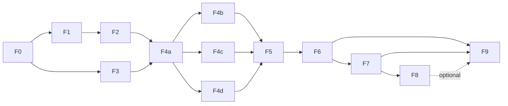

# 22. Frontend Development Plan (with complete mock data)

| | |
|---|---|
| **Status** | Draft, awaiting review. **Development is still locked** until the owner says "start" |
| **Version** | 0.1 |
| **Date** | 2026-11-02 |
| **Owner decision** | Frontend UI/UX first, backend later, all data mocked from the reference (2026-11-02) |
| **Supersedes in detail** | The phase table in `docs/07-planning/17-implementation-roadmap.md` section 0 (that table stays as the summary; this plan is the execution detail, with the same totals) |
| **Inputs** | `docs/04-design-ux/13-public-site-spec.md`, `docs/04-design-ux/reference-analysis/`, `docs/02-architecture/21-modular-monolith-architecture.md`, `docs/02-architecture/20-mock-data-spec.md`, `docs/02-architecture/23-mock-data-catalogue.md`, `docs/03-security-privacy/06-security-architecture.md` section 6 |

## 1. Goal and principles

Deliver the public TeddyPups site as a faithful, responsive, accessible Next.js application running entirely on **complete mock data** (every record in `23-mock-data-catalogue.md`), structured as a modular monolith so that the Supabase backend and admin portal can be added later without rewriting any page.

1. **Reproduce the reference first**; improvements are separate and labelled (`docs/07-planning/16-risk-register-and-decisions.md` ADR-011).
2. **Vertical slices with demoable checkpoints**, not layers: every phase ends with something that runs, is tested and is committed.
3. **Fidelity priority** from the protocol: layout, structure, typography, spacing, images, component sizes, colours, buttons, responsive, then micro-interactions. Motion starts only after static pages are correct.
4. **Architecture is enforced from the first commit** (layer and module rules, `navigation` for links, only `shared/config` reads env).
5. **No backend, no real personal data, no copied media** (placeholders, decision D13).
6. **Mobile is provisional** until the owner supplies mobile reference captures (D14).
7. Every step is committed incrementally with a Conventional Commit message and **no co-author line** (`CLAUDE.md`).

## 2. What "complete mock data" means

The mock layer is complete only when it reproduces the dataset in `23-mock-data-catalogue.md` exactly:

| Dataset | Required count |
|---|---|
| Available puppies | 15 (2 named, 13 unnamed; all imported; 5 Korean Teacup; Boy 5, Girl 9, Boy & girl 1) |
| Gone-home puppies | 27 (15 imported, 12 in Dubai; 3 unnamed) |
| Puppy detail pages | 42, with the 404 for unknown slugs |
| Media references | 132 (130 unique ids): 126 images, 6 videos; each with size, alt, focal point and colour |
| Puppies with video | 4 |
| Family photos | 64 (8 with captions) |
| FAQs | 9 (3 on the home page) |
| Contact form puppy options | 16 |
| Filters | 3 groups, 10 chips |
| Settings | Phone, WhatsApp text, email, address, Maps, 3 social links, tagline |
| Static page copy | 7 pages plus the detail-page and footer fixed copy |
| Templates | Per-puppy WhatsApp text, form prefill and title, page titles and descriptions, JSON-LD |

**Completeness gate** (a test, not a promise): `tests` assert the counts above, unique slugs, resolvable detail routes, the observed template strings for the sample slugs, and that no fixture holds personal data. Phase F3 does not exit until the gate passes.

## 3. Phase overview

| Phase | Name | Est. (h) | Priority | Depends on | Checkpoint |
|---|---|---|---|---|---|
| F0 | Setup and architecture skeleton | 4 | P0 | Owner "start" | M0: app boots, `verify` passes |
| F1 | Design system | 5 | P0 | F0 | M1: component gallery matches tokens |
| F2 | Layout and navigation | 4 | P0 | F1 | M2: shell on all breakpoints |
| F3 | Mock data modules | 5 | P0 | F0 | M3: completeness gate green |
| F4a | Puppies list, filters, detail | 6 | P0 | F2, F3 | M4: puppies flow demo |
| F4b | Gone home and Happy families (+ lightbox) | 3.5 | P0 | F4a | |
| F4c | How it works, FAQ, Contact | 3.5 | P0 | F4a | |
| F4d | Home scenes (static) | 4 | P0 | F4a | M5: every page present |
| F5 | Forms and consent | 4 | P0 | F4 | |
| F6 | Responsive and visual QA | 8 | P0 | F4, F5 | M6: P0 complete |
| F7 | Signature motion | 10 | P1 | F6 | M7 |
| F8 | Polish and illustration tier 1 | 8 | P2 | F7 | |
| F9 | Quality, deploy, docs, Loom | 8 | P0 | F6 (and F7 if done) | M8: release |
| **Total** | | **73** | | | |
| **P0 only** (F0 to F6, F9) | | **55** | | | |

F4b, F4c and F4d are independent once F4a exists and can run in parallel (separate sessions, different modules, no shared files) if time presses.

## 4. Phase details

Task times sum to each phase estimate. **Mock data** shows what the phase consumes. **Commits** lists the planned Conventional Commit subjects (one per task or small group). "AC" refers to `docs/06-quality/15-test-and-qa-plan.md`.

### F0. Setup and architecture skeleton (4 h)

Goal: an empty but correctly structured, linted, tested and building application.

| Task | Work | h |
|---|---|---|
| F0-01 | Scaffold Next.js (App Router, TypeScript strict), Tailwind v4, ESLint, Prettier, Vitest with Testing Library, Playwright config; `package.json` scripts; pin versions after confirming the current stable releases | 1.0 |
| F0-02 | Create the folder skeleton from `21` section 5 for the frontend track only: `src/app`, `modules/{catalog,content,crm,storefront}` with the four layers, `shared/{kernel,lib,ui,config}`, `navigation`, `platform`, `composition`, `tests/{architecture,e2e}`; path aliases | 0.5 |
| F0-03 | Boundary lint rules and `tests/architecture` (domain purity, no presentation to infrastructure, no deep cross-module imports, no cycles, thin pages, `shared` imports nothing) | 1.0 |
| F0-04 | `shared/config/env.ts` (Zod): `NEXT_PUBLIC_SITE_URL`, `APP_ENV`, `DATA_SOURCE=mock`, feature flags (`FEATURE_PUBLIC_CURTAIN`, `FEATURE_ROAMING_MASCOT`) | 0.5 |
| F0-05 | Fonts through `next/font` (Fraunces, Figtree, Shantell Sans; confirm open licences), global CSS custom properties placeholder | 0.5 |
| F0-06 | `npm run verify` (lint, typecheck, unit, architecture, build), `.env.example`, root `README.md`, `.nvmrc` | 0.5 |

Mock data: none. Exit: `verify` green; home route renders a blank themed page. Tests: T-ARCH-01 to 08 (initial subset), build. Commits: `chore: scaffold Next.js app with TypeScript and Tailwind`, `chore: add module skeleton and path aliases`, `test(architecture): enforce layer and module boundaries`, `feat(config): validate environment with Zod`, `chore: add fonts and verify script`.

### F1. Design system (5 h)

Goal: every visual primitive from `reference-analysis/visual-design-analysis.md`, shown in a gallery.

| Task | Work | h |
|---|---|---|
| F1-01 | Tokens: colours (brand, scene gradients, door colours), radii, hard shadows, easings, type scale (Fraunces/Figtree/Shantell roles), spacing, container 1648 | 0.75 |
| F1-02 | `Button` (primary, ghost, whatsapp, ghost-on-dark), `Chip` (filter, link), `StatusTag`, `Kicker`, `SectionNumber`, `Breadcrumb` | 1.0 |
| F1-03 | Static primitives: `Container`, `Card` (info, form, step), `Tape`, `Stamp`, `Polaroid`, `TicketShape`, `NoteShape`, `Pin`, `PhoneFrame`, `Toggle` shell | 1.25 |
| F1-04 | Dividers and patterns: `Scallop`, `Wave`, `QuiltGround`, paper dot grid, wallpaper stripes, plank floor | 0.75 |
| F1-05 | Seven line icons, logo and favicon placeholders (original, not the reference's), mascot placeholder SVG (single pose) | 0.75 |
| F1-06 | Focus ring, reduced-motion base, hover and press states (CSS only), `/dev/gallery` route (excluded from sitemap, `noindex`), component tests | 0.5 |

Mock data: none. Exit: gallery at 1920 and 375 compared against tokens (M1). Tests: component tests, axe on the gallery. Commits: one per component group, for example `feat(ui): add button, chip and status tag primitives`.

### F2. Layout and navigation (4 h)

| Task | Work | h |
|---|---|---|
| F2-01 | `navigation`: typed route registry, `paths.*` link builders (including filter query), menus (header, footer Explore, mobile, bottom bar), breadcrumbs, metadata mapping, sitemap and robots builders; lint rule against raw hrefs; unit tests | 1.0 |
| F2-02 | `Header` (transparent and solid variants, scalloped edge, active paw), `NavLink`, WhatsApp pill from settings | 0.75 |
| F2-03 | `MobileMenu` (native dialog, circular reveal CSS, focus trap, Esc), `BottomBar` (below 768) | 1.0 |
| F2-04 | `Footer` (3 columns, basket mascot placeholder, social pills, tagline) | 0.5 |
| F2-05 | `Scene` wrapper (gradient props, tone), page shell, skip link, 404 page, **`/privacy` and `/terms` placeholder pages and footer links** (pending D16) | 0.75 |

Mock data: settings fixture (temporary inline until F3). Exit: shell correct at 1920, 1024, 768, 375 (M2). AC: AC-003. Commits: `feat(navigation): add typed route registry and link builders`, `feat(storefront): add header, mobile menu and bottom bar`, `feat(storefront): add footer and page shell`.

### F3. Mock data modules (5 h)

Goal: the complete dataset behind ports and use cases, swappable later.

| Task | Work | h |
|---|---|---|
| F3-01 | `catalog`, `content`, `crm` domain types and value objects, errors, ports (`PuppyRepository`, `FamilyRepository`, `FaqRepository`, `SettingsRepository`, `EnquiryRepository`), `PersonalDataProvider` port in `shared/kernel` | 0.75 |
| F3-02 | `scripts/extract-fixtures` (reads the reference; keeps the extraction reproducible); fixtures for puppies (available and gone), media, families, FAQs, settings, testimonial (fictitious attribution), contact options | 1.25 |
| F3-03 | Placeholder media generator: one SVG per media item at its recorded size, colour and focal point, posters for videos, about 196 files, under 3 KB each; media URL resolver | 0.75 |
| F3-04 | Use cases and DTOs: `ListAvailablePuppies`, `ListGoneHomePuppies`, `GetPuppyDetail`, `FilterPuppies`, `GetNeighbours`, `ListFamilies`, `ListFaqs`, `SearchFaqs`, `GetSettings`, `GetTestimonial`, `SubmitEnquiry` (mock) | 1.0 |
| F3-05 | Static copy as typed content files per page (`modules/content/infrastructure/static`) from the extraction, checked against word counts in `23` section 9; metadata, WhatsApp and prefill templates | 0.75 |
| F3-06 | `composition/container.ts` with `DATA_SOURCE=mock`, contract tests for each port, **completeness gate** tests (section 2) | 0.5 |

Mock data: this phase creates it. Exit: completeness gate green (M3). Tests: unit tests per use case with fake and mock adapters, contract tests, schema validation. Commits: `feat(catalog): add domain model and repository ports`, `feat(catalog): add mock fixtures extracted from the reference`, `feat(content): add static page copy`, `test(data): add completeness gate for mock data`.

### F4a. Puppies list, filters and detail (6 h)

| Task | Work | h |
|---|---|---|
| F4a-01 | `PuppyCard` (circle photo with ring and doodles, tilted tag, video badge, name and detail), responsive 6/… columns, grid gaps 40/52 | 0.75 |
| F4a-02 | `FilterPad` (3 rows, 10 chips, multi-select), URL state (`?breed`, `?origin`, `?sex`), `CountLine`, clear filters, empty state, gone-home strip | 1.25 |
| F4a-03 | `PuppiesPage` header (kicker, H1 with underline, self-portrait) | 0.5 |
| F4a-04 | `Gallery` (stacked frame, counter, arrows, thumbnails, video poster), keyboard support | 1.25 |
| F4a-05 | `InfoCard`, `FactGrid` (4 or 5 facts), `ChecklistCard`, state variants (available, gone) with the observed copy rules | 1.0 |
| F4a-06 | `StepsRow` (paw connectors, vertical on mobile), `PrevNextCard` (wraps), `ProgressRibbon`, enquiry form shell | 0.75 |
| F4a-07 | Detail metadata (titles, descriptions, `BreadcrumbList`), 404 for unknown slug, 42 routes generated | 0.5 |

Mock data: 15 available puppies, 27 gone-home, media, neighbours. Exit: filters and detail demo (M4); AC-005, AC-006. Tests: filter logic and URL state tests, gallery keyboard tests, e2e `puppies` and `detail` flows. Commits: `feat(catalog): add puppy card and filter pad with URL state`, `feat(catalog): add puppy detail gallery and info card`, `feat(catalog): add gone-home detail variant`.

### F4b. Gone home and Happy families (3.5 h)

| Task | Work | h |
|---|---|---|
| F4b-01 | `/gone-home`: header, `Kiosk` placeholder, `TicketCard` grid (4 columns), links to detail | 1.25 |
| F4b-02 | `/happy-families`: header, notebook testimonial note, polaroid wall (columns 4/3/2), tape and tilt variants, captions | 1.0 |
| F4b-03 | `Lightbox` (overlay, counter "k / 64", previous, next, close, keyboard, focus trap and return) | 1.25 |

Mock data: 27 tickets, 64 family photos, testimonial. AC-008 (lightbox). Commits: `feat(catalog): add gone-home ticket grid`, `feat(content): add happy families wall and lightbox`.

### F4c. How it works, FAQ and Contact (3.5 h)

| Task | Work | h |
|---|---|---|
| F4c-01 | `/how-it-works`: anchor pills, `SegmentedToggle` (In Dubai / Imported), swapping panels, `IllustrationCard` (skyline, plane route), 4 `StepCard`s per mode, promise card with 3 stamps, delivery blocks, why choose us, CTA card | 1.75 |
| F4c-02 | `/faq`: `Corkboard`, `Note` accordion (one open at a time), `SearchField` with live filtering, counter, empty note, WhatsApp button | 1.0 |
| F4c-03 | `/contact`: contact stack, `ShopfrontCard`, `LetterForm` UI (inline fields, select of 16 options), mobile order (form first) | 0.75 |

Mock data: FAQs, settings, static copy, contact options. AC-007, AC-008. Commits: `feat(content): add how it works with mode toggle`, `feat(content): add FAQ board with search`, `feat(crm): add contact letter form UI`.

### F4d. Home scenes, static composition (4 h)

| Task | Work | h |
|---|---|---|
| F4d-01 | Hero (kicker, H1, lede, two buttons, arched lineup at wide widths only, mascot, quilt ground) | 0.75 |
| F4d-02 | "Meet the pups" as the **grid of ajar doors** (the non-pinned version), 15 doors in 5 colours, tags, names | 0.75 |
| F4d-03 | "Two ways" (signpost on wide screens, two arrows on small), showroom and flight scenes | 0.5 |
| F4d-04 | Journey: steps and the three phone states shown statically (all states on small screens; first state on wide until F7) | 0.75 |
| F4d-05 | Passport book with stamps; sunset skyline | 0.5 |
| F4d-06 | Families facade with 8 polaroids, FAQ preview (3 open), CTA house, footer | 0.75 |

Mock data: 15 puppies, 8 families photos, 3 FAQs, testimonial. Exit: every page exists (M5). AC-001, AC-002. Commits: one per scene, for example `feat(storefront): add home hero and arch lineup`.

### F5. Forms and consent (4 h)

| Task | Work | h |
|---|---|---|
| F5-01 | Shared Zod schemas (`crm/application/validation`): name, phone (E.164), optional email and area, message, 18+ statement, consent flags, honeypot, minimum fill time token | 1.0 |
| F5-02 | `EnquiryService` mock (validation, short delay, success, optional failure switch), rate-limit port with an in-memory adapter, no persistence | 1.0 |
| F5-03 | Wire the contact letter and the puppy enquiry forms: inline errors, disabled while sending, success and error states, fold-and-post animation fallback (static message under reduced motion), WhatsApp alternative on error | 1.25 |
| F5-04 | **Privacy notice and terms page structure**, consent line with a link and unticked optional boxes on both forms, versioned consent text (`CONSENT_TEXT_VERSION`); copy supplied by the owner and counsel (placeholder text clearly marked) | 0.75 |

Mock data: contact options, puppy context. AC-009, AC-025, T-PRIV-01, T-PRIV-02. Commits: `feat(crm): add enquiry schema and mock service`, `feat(crm): wire contact and puppy enquiry forms`, `feat(storefront): add privacy and terms pages and consent line`.

### F6. Responsive and visual QA (8 h)

| Task | Work | h |
|---|---|---|
| F6-01 | Capture protocol at 100% zoom (1920, 1440, 1024, 768, 375): reference and clone screenshots, naming under `qa/` (untracked) | 1.5 |
| F6-02 | Compare and fix the home page scene by scene (`reference-analysis/visual-qa-checklist.md`) | 2.0 |
| F6-03 | Compare and fix the inner pages (puppies, detail, gone-home, families, how it works, FAQ, contact) | 2.0 |
| F6-04 | Mobile and tablet pass 320 to 768, zero horizontal overflow, bottom bar and menu | 1.0 |
| F6-05 | Accessibility: axe on every route, keyboard walk-through, focus order, contrast on dark scenes | 0.75 |
| F6-06 | SEO: titles, descriptions, canonical, Open Graph, JSON-LD, sitemap (public routes only), robots | 0.75 |

Exit: visual QA table has Pass for 1920, 1440, 1024 and 375, no open defect in priorities 1 to 6 (M6: **P0 complete**). Mobile marked provisional. AC-001 to AC-011, AC-025. Commits: `fix(storefront): align hero spacing with reference` style, grouped by page, and `docs(quality): record visual QA results`.

### F7. Signature motion (10 h)

| Task | Work | h |
|---|---|---|
| F7-01 | Lenis smooth scroll provider, reveal-on-scroll hook (`data-armed`/`data-revealed`, stagger variables), reduced-motion bypass | 1.0 |
| F7-02 | Pinned door scroller (sticky stage, horizontal translate, walking mascot placeholder, door opening and photo pop) with the grid fallback below 1024 and for reduced motion | 2.5 |
| F7-03 | Journey: sticky phone with state changes (greeting and chips, photos and video, delivery trail), typing dots | 1.5 |
| F7-04 | Scroll-linked effects with `animation-timeline: view()` and `@supports` fallback: stamps thump, sun set, house door | 1.5 |
| F7-05 | Ticket and polaroid reveals, tag swing, doodle hop, card tilt hovers | 1.0 |
| F7-06 | FAQ note unfold, menu circular reveal and link stagger, toggle transitions, button hover and press polish | 1.0 |
| F7-07 | Motion QA: performance profile, reduced-motion pass, Safari and Firefox fallback check | 1.0 |
| F7-08 | Spare for tuning against `reference-analysis/interaction-analysis.md` | 0.5 |

Exit: interaction checks I-04 to I-09, I-18, I-19, I-23 pass (M7). Commits per effect.

### F8. Polish and illustration tier 1 (8 h)

| Task | Work | h |
|---|---|---|
| F8-01 | Page-change curtain (about 0.8 s: cover, runner, lift) behind `FEATURE_PUBLIC_CURTAIN` | 1.5 |
| F8-02 | Mascot idle rig (blink, ear twitch, breathe), poses | 2.0 |
| F8-03 | Paw cursor (fine pointer only) and paw-print trail layer | 1.0 |
| F8-04 | Roaming mascot overlay behind `FEATURE_ROAMING_MASCOT` (off on small screens if it blocks content) | 1.0 |
| F8-05 | Ambient loops (twinkle, float, plane bob) | 0.5 |
| F8-06 | Illustration tier 1: simplified original SVG set replacing placeholders (doors, signpost, plane, skyline, house, passport, phone) | 2.0 |

Exit: visual comparison of motion against the reference recording within 15%; all behind flags.

### F9. Quality, deployment, documentation, Loom (8 h)

| Task | Work | h |
|---|---|---|
| F9-01 | Lighthouse and axe budgets (`docs/03-security-privacy` NFR), fixes; bundle and image checks | 2.0 |
| F9-02 | Deploy preview and production (Vercel), environment setup, smoke tests on every route including refresh and 404 | 1.5 |
| F9-03 | README, architecture notes, runbook, update the progress and prompt logs | 1.5 |
| F9-04 | Loom script and rehearsal (process, structure, tools, prompts, decisions, challenges, testing, deployment) | 1.5 |
| F9-05 | Final visual QA, acceptance checklist sign-off, release tag | 1.5 |

Exit: M8 release; AC-001 to AC-011, AC-021 to AC-025 pass.

## 5. Mock data use by phase

| Dataset | F3 | F4a | F4b | F4c | F4d | F5 | F6 to F9 |
|---|---|---|---|---|---|---|---|
| Available puppies (15) | build | list, detail | | | doors | form options | all pages |
| Gone-home (27) | build | detail variant, strip | tickets | | | | |
| Media (132) + placeholders | build | gallery | tickets, strip | | | | placeholder QA |
| Family photos (64) | build | | wall, lightbox | | home facade (8) | | |
| FAQs (9) | build | | | board, search | preview (3) | | |
| Settings and links | build | CTA links | | contact | footer | WhatsApp text | |
| Static copy | build | detail copy | headers | how it works, contact | home | consent text | SEO |
| Templates (WhatsApp, prefill, metadata) | build | detail | | | | forms | SEO |
| Testimonial | build | | note | | facade, bubble | | |

## 6. Quality gates

| Gate | When | Tool |
|---|---|---|
| Lint, typecheck, unit, architecture tests, build | Every commit (`npm run verify`) | ESLint, TypeScript, Vitest, boundary rules |
| Completeness gate for mock data | F3 exit and on every fixture change | Vitest |
| Component and use-case tests | With each task | Testing Library, Vitest |
| End-to-end journeys | F4 exits and F6 | Playwright (Chromium first, then Firefox and WebKit) |
| Visual QA | F6 and F9 | Capture protocol and checklist |
| Accessibility | F1 gallery, F4 exits, F6, F9 | axe, keyboard walk-through |
| Performance | F7 and F9 | Lighthouse, profiler |
| Privacy | F5 and F9 | T-PRIV-01 to 10 applicable subset |

## 7. Milestones and demo points

| Milestone | After | Tag (local) | What you can review |
|---|---|---|---|
| M0 | F0 | `frontend/m0-skeleton` | Boots, lint and architecture tests enforce the structure |
| M1 | F1 | `frontend/m1-design-system` | Component gallery |
| M2 | F2 | `frontend/m2-shell` | Header, menu, footer on all breakpoints |
| M3 | F3 | `frontend/m3-mock-data` | Completeness gate and fixtures |
| M4 | F4a | `frontend/m4-puppies` | Puppies, filters, detail pages |
| M5 | F4d | `frontend/m5-all-pages` | Every route |
| M6 | F6 | `frontend/m6-p0-complete` | P0 complete, visual QA |
| M7 | F7 | `frontend/m7-motion` | Signature motion |
| M8 | F9 | `frontend/m8-release` | Deployed release |

## 8. Schedules

Estimates are focused hours for one developer working with AI assistance (not elapsed time).

| Option | Scope | Hours | Use when |
|---|---|---|---|
| **Full** | F0 to F9 | 73 | Time allows everything |
| **Standard (P0)** | F0 to F6, F9 | 55 | Recommended baseline for the graded clone |
| **Minimum viable** | F0 3, F1 4, F2 3.5, F3 4.5, F4 14 (home simplified to hero, doors, CTA; lightbox kept), F5 3, F6 5 (home and 3 key pages at two widths), F9 5 | 42 | The 48-hour limit is tight |
| **Emergency** | F0 3, F1 3, F2 3, F3 3.5, F4 10 (lean pages, no lightbox animations), F5 1.5, F6 3, F9 3 | 30 | Behind schedule at the midpoint; keep all routes, filters, FAQ, forms, deployment and Loom |

**Cut order** if behind: F8 entirely, then F7 (keep grid fallback and basic hovers), then illustration tier 1, then F6 breadth (keep home and puppies), then lightbox transitions. **Never cut:** all routes and navigation, filters, working forms (mock), responsive layout without overflow, accessibility basics, deployment, documentation and the Loom.

Honest note: 55 focused hours does not fit into 48 elapsed hours for one person; the minimum viable and emergency options exist for that reason. The owner should choose the option when giving the start signal.

## 9. Commit and branching conventions

- Work on `main` in small commits (no remote yet); a short-lived branch per phase is optional and merged with a normal merge commit if used.
- Conventional Commit subjects: `feat(<module>)`, `fix`, `test`, `docs`, `chore`, `refactor`, `perf`; a body that says what and why, and the log entry number for process work.
- Each task in section 4 ends in at least one commit; tests ship with the code they cover.
- **No co-author or tool attribution lines** (`CLAUDE.md`).
- Checkpoint tags from section 7 are annotated, local only.
- `docs/08-process/19-development-progress-log.md` and `18-ai-usage-and-prompt-log.md` get an entry per owner message, as before.

## 10. Definition of ready (before F0 starts)

| Item | Status |
|---|---|
| Owner says "start" | **Pending** |
| Choose the schedule option (section 8) | Pending |
| Confirm tooling: Node and package manager, Next.js version, Vitest, Playwright, boundary lint tool, Zod, Lenis (`docs/02-architecture/21-modular-monolith-architecture.md` open questions) | Pending (defaults proposed in F0) |
| "Functions" interpretation confirmed (pure helpers in `shared/lib`) | Pending |
| Media: placeholders (D13) | Done |
| Privacy pages and consent line approved (D16) | Pending; F2 and F5 include placeholders by default |
| Mobile reference captures (D14) | Pending; not blocking, mobile stays provisional |
| Logo and favicon: original placeholders (the reference's logo is third-party) | Default: placeholders |
| Illustration approach: tier 0 placeholders now, tier 1 in F8 | Default |

## 11. Risks specific to this plan

| Risk | Impact | Mitigation |
|---|---|---|
| Pinned scroller and scroll-linked effects take longer than 10 h | Delays F7 | Static and grid versions ship in F4; F7 is P1 and cut-able |
| Illustration work (original SVG) is underestimated | Visual gap to the reference | Tier 0 placeholders in F1 and F4, tier 1 in F8 with 2 h; owner may supply artwork later |
| Fluid type and mixed-zoom screenshots mislead sizing | Rework in F6 | Use CSS values and the 100% capture protocol (`reference-analysis/screenshot-inventory.md`) |
| Mock extraction differs from the live site over time | Data drift | Snapshot kept locally; completeness gate pins counts |
| 14 of 15 puppies unnamed and no local puppies create odd UI states | Edge-case bugs | Fixture rules in `23` section 3 become tests; gaps G1 to G6 verified on the live site before F4a |
| Over-engineering the module layers slows early work | Schedule slip | Layers are thin; empty layers are not created; templates reused per module |
| Motion hurts performance or accessibility | Quality loss | Reduced-motion fallbacks, flags, profiling in F7-07 |
| Font and library versions change | Build breaks | Pin versions in F0, lockfile committed |

## 12. Acceptance and traceability

| Requirement area | Phase | Acceptance |
|---|---|---|
| FR-PUB-001 to 006, navigation, shell | F2 | AC-002, AC-003, AC-010 |
| FR-PUB-009 to 013 puppies, filters, detail, gone-home | F4a, F4b | AC-005, AC-006 |
| FR-PUB-014, 015, 016 lightbox, toggle, FAQ | F4b, F4c | AC-007, AC-008 |
| FR-PUB-006 to 008 home scenes | F4d, F7 | AC-001 |
| FR-PUB-017 to 019 contact, forms | F4c, F5 | AC-009 |
| FR-PUB-022 (data from repositories, mock) | F3 | completeness gate |
| FR-PUB-024 SEO | F6 | AC-002 |
| FR-PRIV-001, 002 privacy pages, consent line | F2, F5 | AC-025 |
| NFR-A11Y, NFR-PERF, NFR-COMP | F6, F9 | AC-010, AC-011, AC-022, AC-023 |
| NFR-MNT-008 to 015 architecture | F0 onward | T-ARCH-01 to 08 |
| NFR-PRIV-018 no real personal data | all | AC-027, T-PRIV-09 |
| Deployment | F9 | AC-021 |

## Open questions

1. Which schedule option (section 8) should be used?
2. Confirm the tooling defaults and the open questions in `21`.
3. Approve the privacy and terms pages and consent line (D16) or keep strictly to the reference?
4. Will original illustrations be drawn (tier 1) or will the owner supply artwork?
5. Should the checkpoint tags and a short-lived branch per phase be used, or commits on `main` only?
